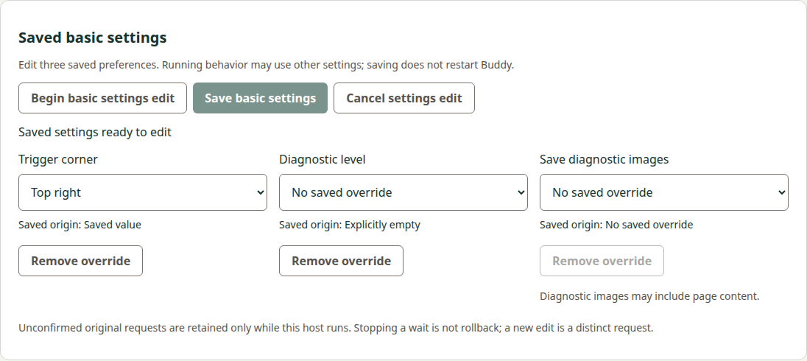
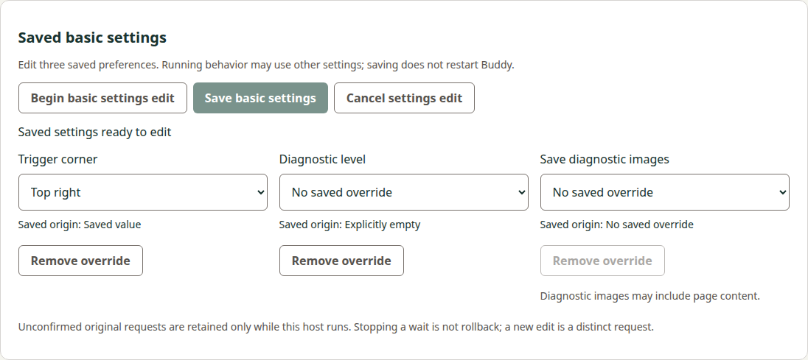

# Shared basic-settings consumer evidence

Source basis: corrected Manager32 `8b54ce9d65eb40ed7a247fc5e830b0e711f9aed6`, successor to reviewed68c467a/084b3aa, original
actual base `f43627ba9fef4054ae2548823698f27f630bfad6`, accepted own precode
`4cac5c3e721ab97270fcd3d706f3b900b4803f8d`/review5587743737, accepted producer82717f
and original captured corpus. This verified scoped implementation is synchronized
and archived in the linked candidate; final composed review and normal delivery
remain external gates. No broad REM42/runtime qualification is claimed. No tablet,
provider, credential or trust work occurred. Local UI uses source Electron; hosted
CI additionally executes the downloaded retained packages without rebuilding.

## Implementation and ownership

The protected optional host method, fixed HTTP/main-frame IPC adapters, strict raw/
reduced validation, fixed Python selectors and shared three-field UI are implemented.
The general saved view still discards its digest and grants no edit authority.
Finite changes preserve omission/null origins; only dirty fields are sent. Internal
prepare and at most one original apply share one13s budget. Original exact private
prepare/input bytes and integrity hashes are retained before possible dispatch.
A120s ready grant and one active/eight unresolved bounds do not evict unknown evidence.

A single private I/O token spans Begin, Save, remote original status and direct
forget prepare/confirm/receipt. Busy acquisition cannot cancel/hook another owner.
Acquired old status invalidates a merely ready editor before I/O. Both coordinators'
targeted cancel checks lane/reference/token; old forget cancellation cannot reach a
new basic apply or invalidate it through a hook. Raw observer receiver stays original;
external wrapped maintenance (including raw run), real navigation and explicit
refresh revoke ready/pending authority. Finally releases only the original token.
Unknown forget/status packets remain unchanged; no automatic retry, service call or
file fallback is introduced. The public UI never displays private hashes or intent.

## Original report compatibility versus synthetic faults

Original45report artifact is byte-identical101745bytes SHA256
`8adbd87c292d886a9aceed52e701cb1941ca8abc8c1671ac187446d32b375b10` from Buddy61685ea.
Capture remains source87bc8d4/executableed2f34f; all45stdout and27present-stdin hashes
plus separately attributed before-shape stdout hash verify. Original general35corpus
is untouched. No producer executable or old version was replayed.

All38basic reports cross the strict private parser and actual shared coordinator/
controller; seven general reports cross their existing saved-configuration controller.
Surrounding phase reports use original attributed specimens. Accepted prepare/status
paths needing retained uncertainty use separately labelled synthetic apply-response
loss; this is not an induced-loss claim for the original producer execution. The
native no-op input is intentionally injected as redundant dirty keys into the test
controller to cover its defensive no-change response; normal UI gestures filter such
redundancy. Its original byte/status proof remains attributed to the captured case.
A full original inspect/prepare/verified-apply sequence also crosses the coordinator/
controller with exact original intent linkage and no private fields in public state.

## Executed local controls

- All203Node tests pass (176base plus27new), including all report compatibility,
  field/origin/patch rejection, private/public phase consistency, actual bounded
  child stdin/identity/cap/nonzero/timeout, original packet retention, deadline,
  capacity, no-repeat, remote-status ownership and cross-coordinator cancellation.
- Eight Python controls pass. Actual local SSH channels exercise all four exact fixed
  selectors with original stdin or no stdin and exit0/2/127; identity samples/route/
  notifications are fixtures. Duplicate/UTF8/framing/input/output/stderr bounds,
  before/after identity change, timeout/close and one-output custody controls pass.
  This is local SSH evidence, not native USB or Windows device qualification.
- Lint and both development/production builds pass. All10existing workflow graph
  controls pass; only commands in existing jobs change. No job/dependency/lockfile,
  SDK, release/version graph or source-maintained own version changes.
- Actual development browser HTTP and source Electron pass full UI/host fixtures:
  finite set/clear and declared-null removal, displayed original value, both widths,
  verified saved file versus runtime, lost reply/reload host-only recovery, no auto
  status/reapply, exact old forget receipt bytes, old forget/basic cancel versus new
  apply, old status busy versus active Save and invalidation of ready, pre/post-apply
  cancellation, stale callbacks and real Electron arity/sender/main-frame refusals.
  Only lower transport/reports are synthetic; actual public guards remain installed.
- Actual HTTP controls independently reject wrong origin/session/query/request shape,
  cap/UTF8/duplicate/private input, document/resource/iframe lifetime and final bridge
  after-await generation. Source helper/main always check final public ready state.

## Focused implementation-review corrections

[Review5588386132](https://github.com/s116821/ReMarkableBuddiesManager/pull/32#pullrequestreview-5588386132)
confirmed two races in68c/084. Before-fix regression logs reproduce both. The
corrected coordinator rechecks original ready expiry after prepare and before
possible apply; ready-at0/Save-at119999/prepare-at120001 returns not-dispatched with
zero apply calls. A resolved apply reply at13001 from Save-at0 returns unknown,
retaining its original packet even before the timer callback runs. Late inspect and
status cannot grant ready or retire uncertainty. A4000ms prepare leaves9000ms for
apply, rather than resetting lower timers. Private budget_ms is validated and
clamped in the actual child supervisor; a hanging synthetic child is killed by its
inherited500ms budget despite a13000ms supervisor default. Python fixtures verify
remaining channel timeouts and identity delay refusal before command dispatch.

The shared controller guards every post-await stop mutation by captured generation,
reference and original context. A deferred old cancel returning not-dispatched
cannot clear newer pending Save uncertainty/retained evidence. A separate regression
ensures stopping a host-only retained read never cancels remote work. Both pass
through actual coordinator/controller code with synthetic deferred adapters.

Exact084 CI Linux Integration118756420331 failed in the preload inventory assertion
at tests/wired-hosts.mjs:73, not pip/dependency download. The original64989-byte raw
log SHA256 b8b8c5f5d83c3d3652072dc38548932e7a87da46d4230cad2d008af8025faccf is
retained in the shared workspace. The exact inventory now includes basicSettings,
with additional invalid private-path/arity refusal assertions. The same common
inventory serves source/packaged and both OS paths. Corrected local production
browser/source Electron wired fixture passes; hosted retained checks remain required.

Current local correction checks:203Node,8Python,10workflow graph,lint,development and
production builds pass. Guarded basic development browser/source Electron and wired
production browser/source Electron fixtures pass again. Inherited MANAGER variables
were removed for these fixture launches; transport/config are explicit synthetic
fixtures. No local retained package was rebuilt. The four images below remain the
previous reviewedf63 captures of the same presentation, not new native qualification.

## Corrections retained with honest attribution

Initial shared-token integration exposed an existing late-preparation regression:
direct invalidation did not release its OWN old token, leaving the next slot busy.
The correction conditionally releases that old owner only; original late/new-preview
assertions pass unchanged. Initial privacy test reused the public connection digest
as a private synthetic digest; distinct private sentinels corrected that fixture
without weakening absence assertions. Initial Python cap assertion expected
reserialized rather than padded original bytes; it now verifies exact retained bytes.
Failed native logs remain separately retained in the shared workspace.

Visual inspection caught dynamic select initialization showing the empty option
despite an actual saved corner. Binding selected options and an explicit UR assertion
corrected the product defect. Native390capture initially clipped its footer because
virtual/native heights differed; matching both heights now retains the complete
panel. Final390/1280browser and native Electron captures were inspected for correct
values/origins, readable controls/disclosure, disabled styling and no horizontal
scroll/private strings. These final images replace neither prior failure evidence
nor a retained-package/physical qualification claim.

## Scope and remaining gates

Source30paths (14existing/16new) preserve179unrelated entries from actualf436 base;
the reviewed initial29path scope gained the existing wired-hosts inventory correction.
Dependency lockfile, original producer corpus bytes, current other capabilities and
all source release-version machinery remain unchanged. Docs expands only the
preserved companion's owned artifacts; original2requirements/4scenarios remain in
its5requirements/14scenarios. No producer or prior inspection ownership is altered.

## Final verification and own lifecycle

Independent implementation reviews5588744362/5588744502 accepted source8b54 and
Docs5e42 with no remaining findings; both original inline threads are resolved.
Docs1c then corrected only the final source inventory count. Ordinary exact source
run39462610206 is fully successful: Title, Checks, Build and both Integration jobs;
Release is correctly skipped for the PR. Its synthetic merge
ee8961a570f798922813ed698fd326d2b4a4e359 has exactly reviewed source tree
3783eb043fad924d7376a52fa46abec0e12620a6, with actualf436 and8b54 parents.
Downloaded artifacts are verified before staging and after integration, without
rebuild. Each OS log contains development/source and retained browser/packaged
Electron basic-editor markers plus source/packaged exact wired-host inventory checks.
Windows native API/NTFS controls and Linux upstream Action controls also pass.

| Retained full job log | Bytes | SHA256 |
| -- | -- | -- |
| Checks118765757482 | 115288 | 550d57ea13e8f8fdd13289842841dfc13b84c2860fc167ed36dbccfcf518663f |
| Linux118766856985 | 89864 | fb9937b3285b1d389973de083d646fc921fe85af8e3b9c29de0a88142774fcc3 |
| Windows118766856946 | 66177 | 48a7f1a20aff6e91315c99d311e83563fd525ba151d0719dd83e24140fa85206 |

| Verified requirement | Implementation and evidence |
| -- | -- |
| Private intent/read-only reconciliation (2scenarios) | BasicSettingsHost original packet/integrity map, lost-apply/status/refusal and fresh-edit/capacity controls |
| Shared explicit editor/session lifetime (4scenarios) | shared controller and both real guarded hosts; navigation/refresh, runtime disclosure, old status/forget cancellation races and stale-stop regression |
| Strict fixed protected contracts (3scenarios) | exact public/private parsers, helper/IPC shape/frame checks, original45corpus linkage, child/Python cap/identity/deadline controls |
| Deliberate bounded three-field save (3scenarios) | finite dirty set/clear/null UI, one-shot coordinator, original-ready/total-budget controls and8record/cross-owner cancellation |
| Attributed paired verification/own lifecycle (2scenarios) | original45bytes/hashes preserved, both ordinary OS retained jobs, four reviewed presentation images and own exact canonical/archive comparison |

All5requirements/14scenarios are implemented and covered; original2requirements/
4scenarios remain included. The new canonical body exactly equals this own delta,
without delta-only headings. Only these11own artifacts move to
2026-10-20-edit-saved-basic-settings-companion; preserve all558other entries from
actual Docs99fa304, including delivered model/restore and other unfinished drafts.
Normal merge of actual99fa introduces no overlap with this consumer's own paths.
The final composed candidate runs public docs/unit/strict checks before publication;
current hosted Docs checks and independent final composed review remain required.

## External delivery and publication observations

Prepare normal exact-head Docs75-first/Manager32-second squash after final pair
review and current checks, preserving topic branches. Compare actual merged trees
to reviewed trees and observe separate main CI and official tag/source/provenance.
Download only the small provenance manifest; compare published package API digests
and completion marker without executing packages or contacting a tablet. No release
or actual-main success is asserted by this archive. The prior inspection publication
watch is complete and is not replayed. Broader configuration/owned-data management,
model consumer, selected activation, provider/runtime/native and whole REM42 remain
open. The four captures are earlier reviewed presentation evidence as attributed
above; original producer corpus bytes and provenance remain untouched.
