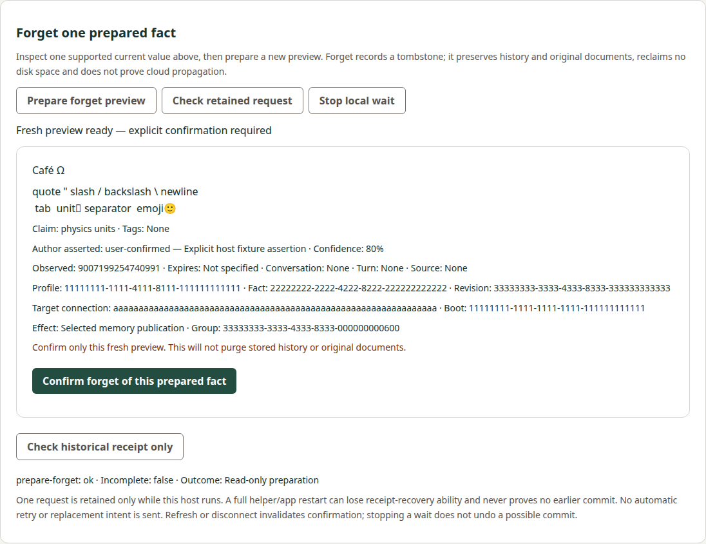
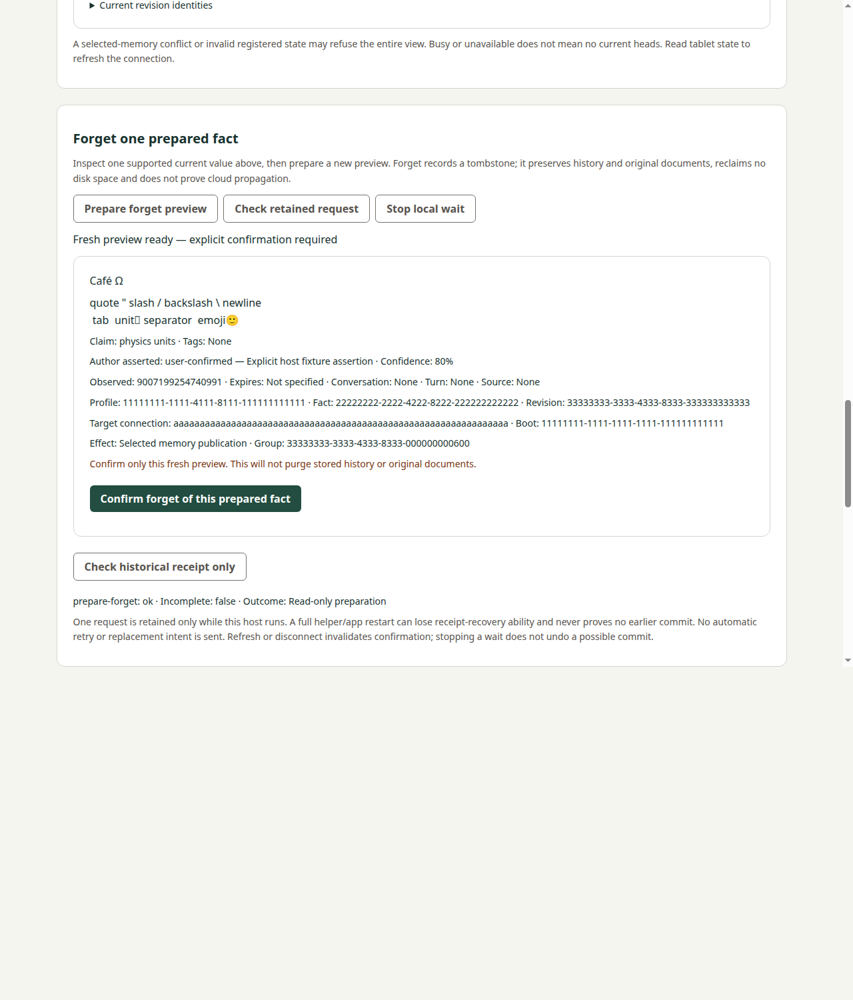

# Prepared memory forget consumer: implementation verification

## Candidate and authority

Accepted precode Docs96c73a9 was independently reviewed in
[5583665573](https://github.com/s116821/ReMarkableBuddiesDocs/pull/69#pullrequestreview-5583665573)
against corrected producer64ff69ba, accepted in5583523433. Implementation started
only after acceptance. This active change remains paired with Manager PR30;
source corrected candidate3084f19 and hosted/review gates are recorded in the public PR packet.
Main owns all Rust/Store/selected publication and receipt proof. This lane has no
producer source changes. Broad management/native/package/provider gates remain open.

## Implemented boundary

One `MemoryForgetHost` per helper/Electron main owns the slot; synchronous prepare
reservation and irreversible claim precede awaits/I/O. Separate external invalidation
wraps the underlying observer while its internal cancellation remains unchanged.
Private original raw report/input bytes and hashes stay in memory; fixed original
input is reused only for explicit receipt. The public bridges carry strict reduced
projections; no private packet or caller-selected path/operation/heads crosses them.
Async validation rechecks host generation before public output. The shared controller
suppresses late completion, preserves uncertainty and serializes cancellation.

UI explicitly prepares a separately validated fact/target/scope, displays its full
supported Fact and requires confirmation. After confirmation it clears old detail,
shows historical acknowledgement only and never removes search results optimistically.
New reads remain deliberate. Refresh/disconnect preserve unknown state in the live
host; no durable custody is claimed. Same-reference retained acknowledgement recovery
requires no extra CLI invocation. New preparation clears an older terminal reference
before cancellation can use it.

## Local verification

| Check | Result and attribution |
| --- | --- |
| Full Node suite | 167 pass, including21 new feature controls; unchanged prior controls retained |
| Python fixed transport | Seven pass; actual local SSH peer uses deterministic public test identities and synthetic route/report data |
| Workflow graph | All ten existing controls pass unchanged; four feature commands added inside existing Linux/Windows Integration stages, no jobs added |
| Lint/development/production | Pass with Node24.21.0 and existing dependencies, no source release version |
| Browser development | Actual helper session/origin/public/coordinator guards; prepare/confirm/ack-only, private refusal, unknown/reload/receipt, cancel before/after dispatch pass |
| Source Electron | Actual IPC/main-frame/arity/coordinator guards and same UI states pass; lower transport/report methods synthetic |
| Responsive/captures | 390/1280 viewport overflow checks pass; both captures below visually inspected |
| Source preservation | All151 unrelated actual72a171a base entries exact;31 changed/new own paths, no SDK/dependency/release-tool changes |

New controls cover every exact phase row, safe numeric/canonical hash refusal,
malformed public/private fields, shared-session reservation/duplicate claim, ready
expiry, newer slot/epoch and post-parse/post-public-validation invalidation races,
full host restart custody loss and truthful prior uncertainty. Actual Node child
supervision exercises inclusive private/raw caps, malformed UTF8/base64/partial
output, foreign identity, nonzero exit, timeout and cancellation. Subsequent receipt
uses identical original input bytes and never repeats confirmation. Preparation
invalid-input preserves the actual report while mapping to public unavailable;
it cannot leave the shared slot permanently occupied.

Initial TypeScript/test-loading failures and canceled UI attempts are retained in
local execution evidence. Two earlier stale-preview tests paused the wrong crypto
step; fixed fixtures precompute report serialization before intercepting the real
public validation awaits. UI failures exposed old-reference cancellation and an
acknowledgement/cancel race; focused regressions and host/controller fixes passed.
One attempted graph command used a nonexistent Python test directory; the actual
unchanged Node graph suite subsequently passed. Guards were not weakened.

These captures use synthetic transport/reports and the separately attributed
913-byte existing-library Rust serialization golden. They are not tablet execution.

## Actual producer compatibility

Exact native artifact copied unchanged from
[Buddy60940ac](https://github.com/s116821/ReMarkableBuddies/blob/60940ac577aa25eb11573619e6c8ea7e86d74885/tests/fixtures/prepared-forget-77e92306-corpus.json):
88192 bytes, SHA256 c80dabef103ab0e6844abf5a3228c6e702a52bcfb92654b338a0db524fdf016b.
Original manifest string SHA256
 da10879b89803761e5a1fc693bc21f2b4aa1d81145aa20fbe75a3fddfc40269e.
All39 actual request/stdout pairs verify all78 original hashes, all phase rows,
nine literal Greek previews and all nine exact canonical Envelope hashes. The
capture used disposable Windows host Stores with production bodies promoted
unchanged to77e92306. Capture-time executable digest was not retained; its explicit
null and note remain exact. No retrospective digest is manufactured. The earlier
bfa35-pair mojibake corpus remains separate historical producer evidence.

Every captured report passes the consumer phase parser with exact flags/outcome;
all successful previews pass public reduction without private pins/configuration.
Local and selected original reports also cross the real coordinator/controller.
A synthetic lost confirmation reply remains unknown; exact actual absent receipt
stays unresolved; exact actual later receipt acknowledges the same original
transaction. One confirmation and two byte-identical original-input receipt calls
occur per case. Captured exact replay and later acknowledgement data are equal.
No producer case was rerun to transfer or consume these reports. Atomic local/
selected interleaving and before/after-commit faults remain separate producer tests,
not claims inferred from the raw CLI corpus or synthetic UI/transport faults.

## Review and hosted correction checkpoint

Root found a confirmed controller P2: after the host recorded the exact original
not-dispatched result but the renderer lost its reply, deliberate same-original
status was wrongly treated as a later invocation refusal and left the UI uncertain
forever. The corrected controller permits that exact retained original status to
settle; later receipt rows, null/foreign references and genuinely unknown records
retain protection. The real coordinator/controller regression proves one confirmation,
no receipt dispatch and a subsequent fresh preparation. All167 local Node tests,
lint/dev/prod builds and browser/source Electron forget UI pass after correction.

Initial ordinary source39410433423 had Title/Checks/Build success, but Linux
Integration118587645562 failed BEFORE new forget controls in the existing packaged
memory-query cancellation fixture. Its deliberately pending query raced the actual
four-second observation refresh between the enabled assertion and click. The fixture
now holds subsequent observation replies pending, and explicitly waits for that
scheduled observation before asserting cancellation. Browser/source Electron pass.
Product refresh invalidation and separate polling controls are unchanged; no public
IPC/private/cancel guard or assertion was relaxed. That initial run is not package
acceptance. The corrected source successor requires fresh ordinary CI and review.

## Completed implementation and composed lifecycle

Corrected Manager source is3084f19b9bd2768ad34298863e031aeb93037ca3. Full
implementation review5584118617 was read, its single P2 repaired, and full
corrected reviews[5584197328](https://github.com/s116821/ReMarkableBuddiesManager/pull/30#pullrequestreview-5584197328)
and[5584198062](https://github.com/s116821/ReMarkableBuddiesDocs/pull/69#pullrequestreview-5584198062)
were read and accepted without blocking findings. Root independently repeated only
the narrow real controller/host recovery proof; this lane did not replay its tests.

Ordinary source39411924112 is SUCCESS at that exact source. Title, Checks, Build,
Linux118592693097 and Windows118592692966 Integration pass; PR Release is correctly
skipped. Direct native logs for BOTH OS jobs contain all four new feature markers:
development browser, source Electron, retained production browser and retained
packaged Electron. Both final upload-byte preservation steps pass. Hosted Checks
118591590832 independently confirms167Node including the original-status regression,
actual39-pair compatibility and bounded child. No local packages were regenerated.
These are software fixture/package checks, not physical/native USB qualification.

Producer full final reviews5584224007/5584224680 were read. Actual Buddy70 merge
b34e6d5cb772b13a833c2830e6770a8b98cf5330 has the exact reviewed60940ac tree15a779bb;
actual Docs68 mergefc8c2fa3b35c38cbb3c0bf4df072970580947c04 has the exact reviewed
0d96ab6 treed3c7cf42. Both independently checked with native GitHub commit metadata.
This candidate composes that delivered Docs base and preserves all507 entries,
including its host-memory-cli canonical requirement and seven-artifact producer
archive. Producer actual-main CI/publication is observed by its owner separately;
PR/tree acceptance never substitutes for official publication.

Only this consumer's six requirements/thirteen scenarios are synced to the new
manager-prepared-memory-forget canonical capability. Its nine artifacts, including
metadata, exact original delta/golden attribution and inspected captures, move to
2026-10-20-manager-prepared-memory-forget; no active copy or unrelated canonical
rewrite remains. Accepted proposal/design/delta/metadata/capture bodies stay exact.
The canonical requirement/scenario bodies match the delta; its source note identifies
this verified implementation rather than calling canonical behavior proposed.

## External final delivery checklist

Implementation/compatibility/package review and own lifecycle preparation are
complete. These external delivery observations remain pending for the final pair:

- Independent final exact-head composition/lifecycle review.
- Required current archive-head Docs checks and unchanged-source check freshness.
- Normal exact-head Docs-first/source-second squash delivery with history retained.
- Actual merged-tree verification and actual-main CI/publication/provenance receipt.

The archive does not assert those future events occurred. Receipts belong in the
paired PR discussion and canonical task; no post-merge implementation change or
publication is manufactured to make this candidate say delivered. Broad management,
installation, provider/account/service, native/physical and whole-MVP gates remain
open. No tablet contact occurred.

Source basis: current native source/spec files, original attributed producer
artifact and local test/tool outputs. Coordination selects ownership and sequence;
it is not independent execution proof.
