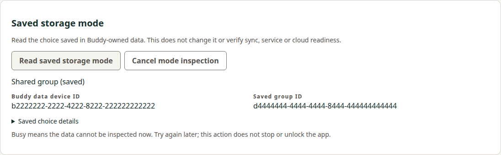
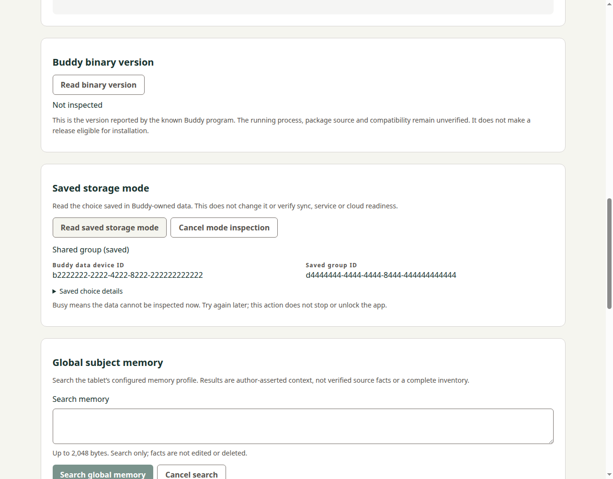

# Saved-mode inspection verification

## Revisions and scope

Central precode `1b507329628c5a5645cf02dbeea986d70f29b08e` was published before
Manager implementation `36040de5ea81b64a67f61c6242b8b0b2b528658c` in
[Manager28](https://github.com/s116821/ReMarkableBuddiesManager/pull/28) /
[Docs64](https://github.com/s116821/ReMarkableBuddiesDocs/pull/64). Full independent
precode review [5581966718](https://github.com/s116821/ReMarkableBuddiesDocs/pull/64#pullrequestreview-5581966718)
was fetched/read and accepted without blocking findings. It accepts the contract,
not this implementation or its eventual delivery.

All132 other Manager main87ba4e7 entries remain byte-exact, including dependency
locks, release helpers and the current metadata graph fixture. CI adds only the
owned Python suite and four host commands within existing Linux/Windows
Integration steps. No stages, permissions, common-suite owner, artifact custody or
component version policy change. The existing packaging recipe copies the whole
selected host directory, so it is unchanged; retained-package resource checks are
still a hosted gate.

## Actual producer compatibility

`tests/fixtures/main-b1-saved-mode-reports.json` contains seven actual
producer-owner Windows CLI reports from a fresh disposable local Store at
`b1fa8a60c547141ccd5e716611863f04f1efdb48`, with original binary SHA256
`fc46c824c02454ac54b5a47f3b92d1f684f7c1658d7fb676dcc7b21fe72376c6`.
This consumer neither rebuilt nor executed that binary. Five original compact
JSON+LF hashes match the supplied capture manifest. Busy and Unsupported hashes
were computed from the producer owner's exact quoted output. All seven reports
pass the real private-report reducer and shared controller with their statuses,
incomplete flags and snapshot identities unchanged; private fields disappear from
the reduced view.

The four saved states and missing Store are captured. Busy used a real owned OS
byte lock; Unsupported used temporarily malformed fixture identity, then restored
its exact bytes. These are not a selected-state corpus. Valid selected format2 is
supported by the backend; Unsupported must not be described as a selected-format
refusal. Original backend suites remain separately attributed and were not rerun
by the consumer owner.

Native PR APIs independently confirm qualified backend source delivery in Buddy67
at `95e0255ad21b30663077e9b5b5e4c0465d7424ed`, following Docs63 at
`2245b7a63a3f510f9ba0a987de975b5990f72f8f`. Full final source/specification reviews
[5582162447](https://github.com/s116821/ReMarkableBuddies/pull/67#pullrequestreview-5582162447)
and [5582162977](https://github.com/s116821/ReMarkableBuddiesDocs/pull/63#pullrequestreview-5582162977)
were fetched/read. They accept that bounded producer's source/own lifecycle and
record passing source39385979365 / Docs39388341691. Producer publication and an
installed target's capability remain distinct from this wire compatibility. This
Docs composition includes the actual delivered backend contract parent.

## Local consumer results

- 43 affected Node tests pass, including9 new saved-mode controls and existing shared observer/controller safety regressions. The nine include actual producer report/hash compatibility, four-mode reduction, seven error statuses, private-field canaries, exact requests, stale/replaced/canceled/refresh results, actual bounded child dispatch and actual authenticated browser-helper refusal of an unreduced private report.
- Seven new Python controls pass with the existing Paramiko5.0.0 test runtime. They exercise identity before dispatch, inclusive byte bounds, duplicate/invalid UTF8/partial/nonzero output refusal, stderr bounds, timeout/cleanup, the outer deadline/completion race and an actual owned socketpair SSH peer with fixed inspect command and empty stdin. Route/notice/semantic report data are fixtures; the peer uses fixed publicly known test identities, not a user's keys or tablet.
- All10 existing actual-YAML/expression/jq/Windows failure-propagation graph controls pass. An initial run refused the new test's --development argument under the existing allowed-command guard. The new test now uses development as its default and --packaged for retained packages; the fixture and every guard remain byte-identical. The original failed log remains preserved locally.
- Full lint and development/production Angular builds pass. Development browser and source Electron new-view tests pass with real rendered controls,390/1280 layouts, refusal states, token/binding/root removal, cancel, same-ID refresh, disconnect and Node isolation.

The UI harness initially failed because Playwright's Electron evaluation context
does not support dynamic import. A test-only loader correction uses the current
Node24 main module loader; the real production IPC authorization/reduced-view
validator stays installed while only transport methods are substituted. The
original failure and corrected successful run remain separate. No production test
hook, OS setting change, system package installation or local package rebuild was
needed. Existing offscreen runtime/resources were reused and stopped after each
run. The captures below were inspected visually and copied without editing.

These captures are renderer/interaction evidence with explicit synthetic
connection and semantic reports, not fresh device observations. They do not
replace actual producer-parser compatibility or retained-package validation.

## Requirement and scenario mapping

| Requirement | Implementation and qualification |
| --- | --- |
| Shared explicit inspection | Fixed Python command and identity-only request; owned SSH-peer and both real host bridge/UI controls. |
| Bounded reduced authority | saved-mode.mjs private reducer/public validator; actual seven-report corpus, malformed/boundary tests and private-field canaries on both bridges. |
| Saved intent versus readiness | Typed four-state view, null-mode handling and status/metadata labels; actual producer cases and both renderer fixtures. |
| Session-bound results | Controller generation plus host identity brackets and explicit connection-refresh invalidation; replacement/cancel/same-ID refresh/disconnect controls. |

All four requirements and seven scenarios are covered. The original source,
transport, semantic fixture and rendered evidence scopes remain distinct.

## Hosted source qualification and scoped lifecycle

Ordinary exact source run [39389753065](https://github.com/s116821/ReMarkableBuddiesManager/actions/runs/39389753065)
at36040de passes Title, Checks, Build and both Integration jobs; PR Release is
correctly skipped. Checks includes137 Node tests and the seven new Python controls.
The completed [Linux job118519223907](https://github.com/s116821/ReMarkableBuddiesManager/actions/runs/39389753065/job/118519223907)
and [Windows job118519223860](https://github.com/s116821/ReMarkableBuddiesManager/actions/runs/39389753065/job/118519223860)
logs were fetched directly through the native job-log API and read. Each contains
passing development-browser/source-Electron and retained-production-browser/packaged-
Electron markers, including actual IPC arity/reduced-view refusal and packaged
helper/module byte checks. Both final integration upload-byte verifications pass.
No package was rebuilt during Integration or locally for this evidence.

Full independent implementation/active-contract reviews
[5582319090](https://github.com/s116821/ReMarkableBuddiesManager/pull/28#pullrequestreview-5582319090)
and [5582320837](https://github.com/s116821/ReMarkableBuddiesDocs/pull/64#pullrequestreview-5582320837)
were read in full and accept36040de/d4cb80f without blocking findings. The reviewer
independently matched all seven specimens to the original producer files/manifest
and inspected both captures. Current active-contract Docs39389944357 passed all
three checks. These source and review observations qualify this bounded software
capability; no physical/provider/native inference follows.

Only this capability is synchronized into the new canonical manager-saved-mode-
inspection specification and moved to its dated archive. All four normative
requirements and seven scenarios are copied exactly; the historical planned-
source note remains only with the original delta. Original proposal/design/delta,
metadata and images remain unchanged. All other delivered Docs entries survive.
The task checklist separates the qualified implementation/candidate from external
final lifecycle review, current archived-head checks, normal delivery and actual
main/publication observations, which remain required. This archive candidate does
not assert those future events. Whole REM42, mode-changing UI, provider/sync/restore,
live-model, physical USB/native and updater qualifications remain open.
