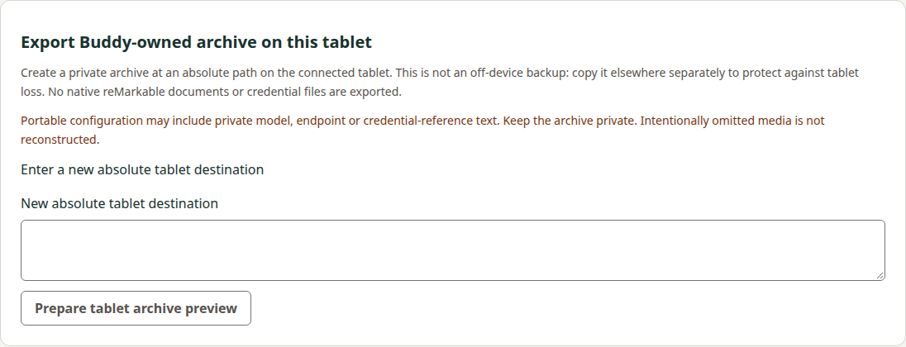
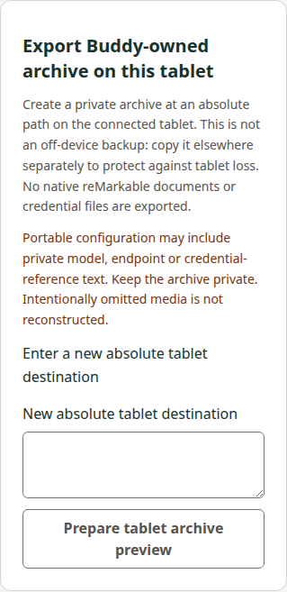

# Shared ordinary export consumer evidence

Current verified source862402c99c7e443bf24b2e2b953a65434ceda86a passed ordinary both-OS CI and focused review. This delivery synchronizes and archives only its three requirements/seven scenarios. Earlier sections retain chronological checkpoint statements; the final receipt below supersedes their pending-state wording. Final composed review, normal merge and actual publication are separate gates.

Source basis: Manager35 02b4eeba9acbf27be07c6edfc1d5e0807a7d9437 (product accepted at051112dffc5bfd6670be59212fe7e5a7740d8640), actual corrective basef7e4a16ddb6f9f4ecfd6b433958996426893078a and actual Docs0399b2dbb57616a1c24e805a1afd23db62afbc9b. Precode eeea00be/review5590342069 was read completely before API/source work. This is an implemented active candidate, not current hosted both-OS success, implementation acceptance, archive/merge or native qualification. Separate model/test-fix actualmain39483861642 publication is CLOSED at Manager v0.20.0 / actualf7; it is not replayed or duplicated by this change. Main owns producer/credential work.

## Implemented boundary

Both companions now expose explicit on-tablet private archive preview, separate confirmation and original status. Destination is exact opaque POSIX input through stdin only, never shell interpolation, public diagnostics, safe state or logs. Request16384/public8192/private16384/child24576 caps are isolated to the new route. Both original apply/status packets are encoded and bounded before ready authority. Source summary/config/media disclosure is finite and origin-bound; no transfer, cloud/network-drive backup, restore, initialization, service/provider/credential/producer action occurs.

The one120s ready grant and one13s invocation preserve exact original operation/config/destination/summary/intent/archive conditions. Confirmation dispatches at most once. Host retains only one ready or at most8uncertain private destination+intent packets with integrity hashes. No implicit eviction/reprepare/retry/delete or restart recovery promise. Terminal known success/refusal clears mutable originals; not-published can leave a partial directory, unknown retains original status context and later refusal cannot settle it. Status proves current complete closure, not historical publisher/completion. Terminal possible flags clear before final publication so late invalidation cannot resurrect settled records.

Renderer draft and actual textarea clear synchronously before first prepare/status waits and on refresh, persisted pagehide, disconnect, other maintenance, Stop, expiry and destroy. Exact CRLF/loneCR/Unicode/trailing path mapping reuses the existing pure helper, extracted mechanically to host/opaque-text.mjs with old model exports preserved. Stale completions/Stop guard generation/reference/original; a prepare without a public handle stops locally without global cancellation. Explicit status pauses scheduled observation before its bounded request. No immutable JavaScript/IPC/OS zeroization claim.

Protected loopback HTTP and main-frame-only IPC share the actual four-lane MaintenanceIO. Busy performs no hook/cancel/I/O; acquired work invalidates all other idle grants, retaining original receiver/token ownership. Per-reference cancellation cannot release or cancel a newer unrelated operation. Old API caps/protocols/corpora and release/version machinery remain unchanged; only commands inside existing CI jobs were added.

## Original reports versus synthetic surroundings

The112203-byte historical ordinary-export-adee57d-corpus.json remains SHA2562aedfcbbda9727bfdbba0767aeb6e059838c528a249103b819a096615d9de974. All38reports/76rawstdin+stdout hashes independently match. Captureadee57de94478e78627b45cb21ace470f8070bb4/executablefe26551d2814b1098f87bb5324bafbf17291547cb8addfbe385bc03e152cb085 PRECEDES producer reservation correction. No producer binary replay, corrected-build/Linux/device durability claim or historical transport-loss relabelling.

All38 original streams pass actual JS/Python private report parsers unchanged. Original successful Windows destination/config hashes are NOT POSIX host authority: current host binding rejects them. Successful POSIX coordinator/child/SSH/UI cases use separately labelled synthetic reports and exact synthetic paths; no original report or hash is rewritten. Historical status-after-verified-apply keeps that attribution, whereas reply loss is a synthetic surrounding fault. Independent Node/Python references match85-byte empty archive2d61ecb63ec1e95d63e178bad36e1a04131c04e586a00c829782f62c7daa1d61, empty history19bf4c537633f421ba1fcec5e6897e9a29a392d701b7fe2ecdce93c21ec1272b, and85prefixed path bytes/c3796fdb66cb881865a3224c05b56661ce3ac4292e2ccc88a8bbd669ae18ea4b.

## Executed controls

- All240Node tests pass:226baseline plus14export controls. Strict private/public finite action/state/shape/identity, path/scalar/count/caps, original binding/packet mutation, preview/confirm/partial/unknown/status/refusal, ready expiry/late phases, capacity, old cancellation and shared UI lifetime pass.
- Nine Python controls pass including9actual local SSH selector/exit combinations for prepare/apply/status, exact synthetic POSIX stdin and fixed commands. Route/notices/identity files and reports are fixtures; duplicate/UTF8/framing/bounds/nonzero/stderr/postidentity/timeouts/inherited budget/single output pass. This is POSIX socketpair evidence, not Windows USB/tablet qualification.
- Actual Node-supervised children verify inclusive24576/private stdin, oversized/identity/nonzero refusal,500ms inherited timeout/invalid-budget no-spawn, and original packet retained after timed apply.
- Actual guarded development browser HTTP and source Electron UI pass exact private path/confirmation, synchronous persisted-pagehide/Read/prepare-fetch clearing, reload with no automatic status/reapply, original byte-identical apply/status packet, refused-then-matching status, all six ready invalidation directions against model/basic/forget, pre/post-apply Stop and no draft refill. Browser invalid query/duplicate/body cap and native arity/frame/extra-field guards pass. Lower producer transport is synthetic.
- Existing actual model editor source-host suite and exhaustive wired preload inventory pass after pure helper extraction; all old member names remain. Lint and development/production builds pass. All10unchanged workflow graph controls pass. No local retained package rebuild/execution occurred; current ordinary hosted Windows/Linux retained-browser/packaged-Electron jobs are still required.

Four current actual source-host captures were visually inspected at390/1280: readable privacy/durability copy and complete controls, visible destination field boundary, no overflow or private draft. They do not establish native device behavior.

## Preserved corrections and remaining work

The first packet-overflow fixture used a null snapshot digest, which made its packet62bytes smaller than the independent nonnull reference; matching that reference corrected the fixture. The first TS build used String.isWellFormed absent from this project's TypeScript library; explicit existing scalar iteration fixed it. The first App integration mechanically expanded a single-expression pagehide arrow without braces; adding the required block fixed compilation. All failed logs are retained.

Visual verification caught the initial unstyled input class; it now uses the established ui-field control. A later raw cross-lane fixture interleaved automatic state polling with async forget validation; it now pauses via the normal model-editor UI first. The product's explicit export status flow also pauses observation before its request. No sleep/timeout increase or weakened assertion was introduced; current complete guarded suites pass. These corrections are not independent passing runs.

Source35paths(16existing/19new) preserve209other actualf7 entries; the extra path is the lifecycle diagnostic test successor below. Original other maintenance protocols/coordinators/transport files and corpora, application dependency lockfile and tag-only release machinery remain exact; the separate release-Python certifi pin is updated below. Docs adds only its own11active files to596actual0399 entries. Current hosted checks and independent implementation review precede own3requirements/7scenarios canonical synchronization/archive, final composed review and normal Docs-first linked delivery. Actual main/tag/provenance observations remain separate. Broader transfer/restore/provider/runtime/native/wholeREM42 acceptance stays open.

## Original integration failure and diagnostic successor

Original051 run39484745242 Linux118843560344 FAILED before the new export tests in the existing forget reload startup-status requestfinished wait at14000ms. The initial corrected prepare response completed6063ms, and the app bootstrap/status node was present. One startup request at76ms had no completion by the bound; that alone does not identify abort, routing, server or browser cause. Full71647byte log SHA2560d963fc91effb2b9d3c1397a9730b7e09339fdb7ebe2edf5b2d245a8626b054a is retained. No prior failure is rerun/relabelled as qualification.

Source5e36b4e changes ONLY tests/memory-forget-hosts.mjs over accepted051 (243other entries exact): record matching failed/finished/header events and synthetic route delay/continue lifecycle with fixed metadata, no body/text/path echo. The existing6s delay/14s bound, UI assertions and product/protocol code remain unchanged. Local lint/full guarded browser/source Electron forget suite passes: startup headers6250ms/status200, finished6251ms; initial6109ms. These diagnostics do not claim to fix an unidentified mechanism. Focused diagnostic review5590853941 accepted this one-file delta. Its fresh normal CI39486470093 stopped in a separate dependency audit before tests as recorded below; current required hosted checks remain open. Export source acceptance5590692268 remains applicable to unchanged product code. No archive or merge while current required checks remain unresolved.

## Independent release-tool audit blocker and narrow pin update

Diagnostic5e36 Checks118848143073 stopped before product lint/tests/build/integration: the maintained pip_audit found certifi2026.7.22 affected by [GHSA-6q48-6c7w-9gw2](https://github.com/advisories/GHSA-6q48-6c7w-9gw2), published2026-10-20T19:35:05Z, fixed2026.10.19. This is distinct from the051 reload failures and does not supply lifecycle evidence. Both original051OS logs are retained: Linux71647bytes/SHA0d963fc91effb2b9d3c1397a9730b7e09339fdb7ebe2edf5b2d245a8626b054a; Windows55034bytes/SHA2e309165da976543d8e65e9509f054ec21fe48e1b7b6e61f9f7596674cf4b883.

Source02b4eeb changes only release/python-tools.lock over5e36: certifi2026.10.19 and its two authoritative PyPI wheel/sdist SHA256 hashes. All other pins/hashes remain exact; certifi has no dependencies. An isolated complete --require-hashes install passes. The host lacks ensurepip, so the audit's temporary resolver environment cannot initialize locally; after that complete pinned install the maintained pip_audit --require-hashes --disable-pip path reports no known vulnerabilities. CI retains its unchanged full audit mode and must pass it, then all normal bothOS source/retained integrations. No audit suppression, ignored advisory, new timeout or product/dependency API change.

Local release-profile DEVELOPMENT metadata compile also passes the full guarded forget suite (initial6116ms, reloadheaders6217/finished6217), without rebuilding a retained package. That environment check did not reproduce the CI reload failure and does not establish its cause or fix it. Current normal CI for02b4eeb remains required. Source051 product acceptance5590692268 and5e36 focused diagnostic acceptance5590853941 remain accurately scoped; this narrow pin successor requires focused review. Archive/merge/publication remain open.

## October22 original results and focused successor

Original02b run39487349681 passed Title/Checks/Build. Linux Integration118852737760 passed pip installation and reached the retained packaged forget reload: headers200 at6056ms, then net::ERR_ABORTED at6056ms; the unchanged requestfinished14000ms assertion timed out. It never reached export. Full73021-byte log SHA2567cdc639b345b80cefd2867a834b775e252f8a910e35c6eb56248cdecb4a572ac is preserved. Windows118852737580 passed forget and failed the new export delayed-prepare Stop setup: Prepare remained disabled. Full63824-byte log SHA256fe3666ced15c19798b352c63469f7bbe7025e5f3f6faad71cba5b99347a6caf1 is preserved. These are distinct failures; a shared cause is not inferred.

Focused source388f10e1e362e110546b9ebbbd22ab6163f76e39 pauses observation synchronously when a supported idle destination field receives focus, before editing can race the4s poll. The field refuses editing while model/basic/forget work is busy. Explicit refresh/disconnect and existing private draft invalidation stay intact. The host test now waits for a changed observation timestamp rather than a possibly old model node, and pastes only after enabled-field focus. A controlled clock installed before observation exercises4500ms and verifies destination preservation plus unchanged observation count. Removing ONLY the focus handler makes the destination assertion fail with an empty value; restoring it passes guarded development browser and updated source Electron. The first negative-control attempt installed its clock after the timer and incorrectly passed; that test setup was corrected before acceptance. One subsequent native attempt used the preceding production output while its replacement build ran and failed the observation-count assertion; after the completed current production build the full both-host source suite passed. No retained package was rebuilt or executed locally.

Separate diagnosticf4b27a303baca7cfde5f2ea2c8cc683fb3ab609f adds fixed bounded reader lifecycle markers (headers/chunk/EOF/cancel/failure) and a finite unknown-rendered boolean to the existing forget test. No response/request contents, path, reference or arbitrary status text is logged. The6s route delay,14s bound, requestfinished assertion and all semantic assertions remain unchanged. Local guarded browser/source Electron forget controls pass; the browser records headers/chunk/EOF/cancel/cancel-complete and a finished request. This does not reproduce or fix the hosted Linux abort. Hosted diagnostic results remain required. All240Node tests, lint and current development/production builds pass.

A separate newly published [GitPython advisory](https://github.com/advisories/GHSA-83vg-56qc-22m7), CVE-2026-114145, published2026-10-22T16:41:14Z, affects the existing3.2.0 release-tool pin. [Official PyPI3.2.1 metadata](https://pypi.org/pypi/GitPython/3.2.1/json) supplies non-yanked wheel d66b0832aa8755c1a84892937282df0befb16c97e5a64aeebd68be9c5e323f53 and sdist0f1229ec5c057bdabdeeda8bda4f17bda679ab33dbccc00f24e6a480553c8613. Dependencies exactly match3.2.0. The narrow successor changes only this pin and its two hashes; all other pins and full CI audit remain unchanged. Complete isolated hash-locked installation passes, and the maintained local post-install --require-hashes --disable-pip audit reports no known vulnerabilities (the host ensurepip limitation remains as above). No application version is maintained in source; these are third-party dependency pins.

Current ordinary bothOS integration, focused successor review, own spec sync/archive and final paired delivery remain open. No tablet/provider contact or broader release qualification follows from these local controls.

Exact current source862402c99c7e443bf24b2e2b953a65434ceda86a consists of the focused388f10e correction, f4b27a3 diagnostics and three-line GitPython pin successor862402c. Its predecessor f4b27a3 CI39828100206 Checks119996738665 failed ONLY the newly published GitPython audit before product lint/tests/build/integration. Full57700-byte log SHA256e8e37e4768fdfa27baf65af4f0f07d21f346c7829a32361ad1abfff3f0924260 is retained; it provides no Linux reload or export evidence. Current source CI and focused review remain required; no blind rerun or failure suppression occurred.

## Final current hosted receipt and own lifecycle — October22

Exact Manager35 source862402c99c7e443bf24b2e2b953a65434ceda86a ordinary [run39828286504](https://github.com/s116821/ReMarkableBuddiesManager/actions/runs/39828286504) completed successfully: Title119997312837, Checks119997388044, Build119998093681, Linux Integration119998912551 and Windows Integration119998912348 all PASS; PR Release120005612744 correctly skipped. The retained browser/packaged Electron suites and source/development suites completed on both systems using the staged build artifacts; integrity gates passed. Full Linux95655-byte log SHA25623adfa0d9043513fcdba213fbe552c9eb06b2456429c633125aa5f1ef0827b49; Windows69071-byte log SHA2566d4561e1830d989afacdc1aae154e93e0b75136318b5fc741dae3cb35f2d0d22. Both logs explicitly complete guarded export and forget controls. All four forget reload cases record headers/chunk/EOF/cancel/cancel-complete plus requestfinished. Current success does not explain or repair the historical Linux abort; its original failed logs and the distinct Windows export and audit failures remain preserved above.

[Focused source review5621946904](https://github.com/s116821/ReMarkableBuddiesManager/pull/35#pullrequestreview-5621946904) and [paired evidence review5621947264](https://github.com/s116821/ReMarkableBuddiesDocs/pull/81#pullrequestreview-5621947264) were read completely and accepted without blockers. They cover the six-file successor over02b; 238 other source entries and606 other preceding Docs entries remain exact. Earlier full product review5590692268 read all33original paths, independently ran12pure protocol/coordinator/controller controls on Windows Node24.11.0 and inspected all4images; that logic check is distinct from the supported Node24.21 current CI. Current Manager scope remains35paths(16existing/19new),209actualf7 baseline entries preserved. The exact historical38reports/76rawhashes remain compatibility evidence without replay or corrected-build attribution.

Own central delta/canonical requirement bodies match exactly: three requirements/seven scenarios. Accepted design, contract body after its historical introductory marker, delta and4image blobs remain unchanged. Proposal and tasks now distinguish completed own implementation/archive/delivery preparation from external final review/merge/publication. Docs main4dddc1a8369de0c394a9ea7ecb829d7659cf38da, including unrelated delivered credential artifacts, is composed and preserved. Final Docs CI and independent composed acceptance must pass before normal Docs81-first/Manager35-second exact-head squash. After merge, observe actual tree equality and main pipeline, then tag target, release completion marker and small provenance/API asset digests separately; do not rebuild/download/execute release packages merely to assert publication. Prior v0.20.0 is closed and must not be rewatched. No tablet/provider/native/transfer/restore/whole-MVP qualification is claimed.
