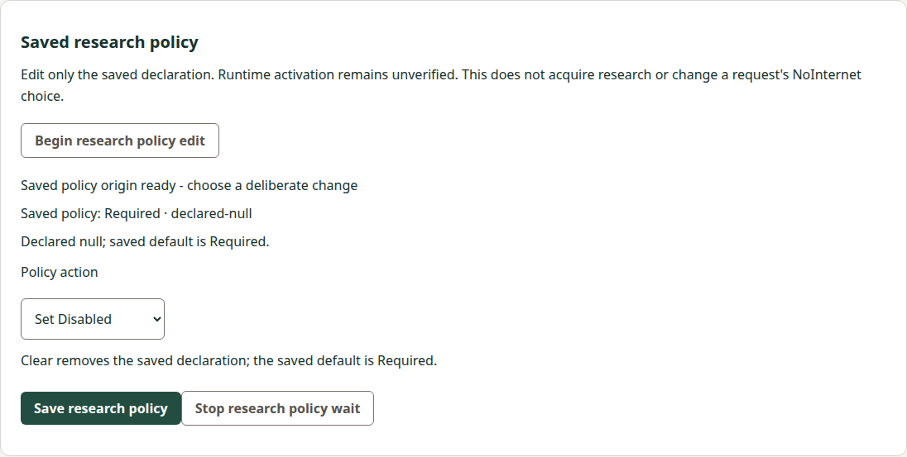
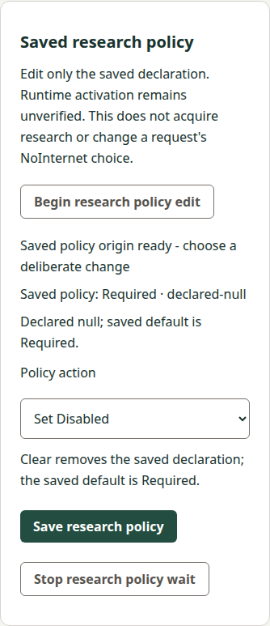

# Saved research-policy consumer local implementation

## Exact source, contract and composition

Independent concrete precode acceptance: Docs0548c73ac335bc34c9d6cfb972e82c7b868ba4f3, REM-42 review884b770b-5061-48fa-afbf-cbbe6fa03f2f. All six contents and producer inputs were independently matched; Root separately passed strict OpenSpec validation before any new Manager source edit.

Normal public read-only fetch and remote inventory established actual Manager mainb8f04d406be76a767e9b1826a2ca32e54b765f81 and Docs main11090c3a8f2cd1b1578798ab390cd757b315d0c3. The accepted proposal composed normally with current Docs in dfca455ce31868497aa046bb430e4b4b7e1122fb, preserving all six accepted file blobs at that step. Actual delivered Manager has model/basic/forget/export; research adds a fifth lane. No saved-memory implementation was silently included. Preserved independent source0240bb073ff77049d117c1d8cab480990654cd1c and Docsfa204ab60fcfbeef20dd8b3bf6fd0316916e3f49 refs/evidence remain untouched.

Local implementation is Managerd9aba631e65ef42358ccbcc827fa596b6455ac7e, tree9eafaf4cf8eda649c4cbf82447f3d5379a88b074, parentactualb8. Its28 paths are13 existing changes/15 additions;233 other base entries are exact. No Rust/backend/SDK/framework/dependency/release/version-authority change. All application versions are still minted from tags/build time. Existing CI jobs only add the bounded suite and keep upload-byte/audit gates.

## Requirement and scenario mapping

| Requirement/scenario | Native implementation and meaningful local evidence |
| --- | --- |
| Separate explicit saved edit | Separate research-settings protocol/coordinator/transport/controller and guarded routes. Synthetic tests exercise all4 original declaration states ×3 actions, exact origin transitions, unchanged unrelated Reader/Writer values and producer no-op apply count. Clear removes; setting required from absent/null remains a real declaration change. |
| Invalid/stale/unsupported conditions | Fixed path digest, strict framing/duplicate/UTF8/version/type/bounds, original operation/base/path/patch/target/after-view checks, expiry/aggregate budget and actual supervised child refusal. Broad saved-configuration v1 files/DTO remain unchanged. |
| Original uncertain reconciliation | Lost apply, later unavailable/unresolved/desired state, original intent-only status, eight-record capacity without eviction or extra dispatch, caller mutation/private copy and retained renderer reload. No retry/reapply. |
| Busy/Stop/stale callback ownership | Real five-coordinator fixture covers all20 directed pairs. Busy performs no hook/cancel/I/O; old targeted cancel/completion preserves a newer token; controller late Stop/status-pause controls cannot settle a new save or clear a new choice. |
| Saved-only results | Every report requires runtime unverified. Both actual source hosts display declaration origin, resolved saved policy and explicit unverified runtime/NoInternet boundaries. DOM selection clears synchronously before Save/pagehide/sibling edit. Existing query/Reader/Writer content remains intact. |
| Complete attributed lifecycle | Source-content implementation acceptance, branch publication and current-head hosted Windows/retained qualification are recorded below. Own canonical sync/archive is complete; final composed review and actual delivery remain pending. No native/runtime readiness or whole-project claim. |

Three requirements/six scenarios are mapped. Tasks1.1–1.3,2.1–2.3,3.1–3.2 have supporting local evidence. Tasks 3.3 and 3.4 are verified after current required qualification and own canonical sync/archive. Tasks 3.5 and 3.6 remain external observations for final paired review/current Docs CI and actual delivery. Final paired review and actual delivery are separate external observations, never pre-checked. This is not final delivery acceptance.

## Checks actually performed and source attribution

- ESLint and full Node suite:262 passed, zero failed/skipped/cancelled (241 existing plus21 new groups). Includes strict protocol/phase/vector, actual guarded HTTP, supervised child, controller and cross-lane cases.
- Python transport:9 groups pass, including12 actual local socketpair SSH selector/exit cases with deterministic public fixture keys, synthetic route/notices/reports. These never contact a tablet or user credential.
- Matching current native source content compiles in development and production. Guarded development-browser and source-Electron UI checks pass, including actual main-frame IPC/arity/frame/cyclic-input rejection, finite set/clear, original status, Stop/unknown/reload, synchronous local-choice clearing and existing draft preservation.
- Existing wired/preload inventory and model editor source regressions pass separately. Current four captures below were inspected: complete readable narrow/wide panels, existing shared ui-field styling and no horizontal overflow. Native capture includes a panel-bounds assertion and full actual viewport.

These commands ran immediately before committing the identical native source contents as d9aba63; per-file manifests pin those contents. Developer build version metadata was generated from b8 plus dirty source, not mislabeled as a clean hosted d9 package. This local content verification does not replace exact-revision frozen-artifact CI. Source and retained checks remain separate: no local retained-package build/execution, Windows run or producer/backend replay occurred.

Public checks: npm run lint; npm test; npm run build:development; npm run build; Python -m unittest discover -s tests/research_settings -v; npm run test:research-settings-hosts; npm run test:wired-hosts; npm run test:model-settings-hosts, with an isolated offscreen display on Linux. New CI source/--packaged invocations use existing Windows/Linux jobs and existing artifact upload-byte identity. No resources/jobs or policy suppression added.

## Preserved failure lineage

Initial core run failed7/7 because three renamed strict key-order expectations were wrong. The existing failure log remains core-tests-first.log; corrected core run passes7/7. An early full run begun before that correction is retained as node-tests-first.log, not a successor pass. First expanded consumer run passed16 groups and failed to load the controller test because Node strip-only mode rejects TypeScript parameter properties. The controller now uses explicit field declarations; consumer-tests-current.log retains that original failure and consumer-tests-fixed.log has20 passing groups before the final late-Stop regression was added. Final262 full suite includes that new21st group.

Earlier pre-style UI succeeded with an unstyled select; final source uses the shared ui-field class, was rebuilt, rerun and captured. Early logs are not relabeled as final. No historical producer corpora or old release qualification were replayed.

## Local log receipts

These are workspace evidence, not hosted Windows or retained-artifact results.

| Log | Bytes | SHA256 |
| --- | ---: | --- |
| `lint-final.log` | 20 | `6ba41d3386946f3480608c0bcb80bb893d785c187db4178012a840ea9081d89b` |
| `node-final.log` | 38512 | `a7f3d4082af004f34110d1ea99ced500f50b7f1f5ae13b154446ceeb68bee27d` |
| `transport-current.log` | 1498 | `f8f869777f81b620f4ecbcbffcc6bc4276495e6694a5ec1f90207ee3d4d57dc1` |
| `build-final-dev.log` | 592 | `44308f4b95c8b21f6ef46dc25e1dab88fde3f3601ea7390aa6f0be3397cb2f12` |
| `build-final-prod.log` | 631 | `502f15a98e9807f9569e2fbbb1ec179d0996da9c99ee452cf802410a68fd349a` |
| `ui-final.log` | 328 | `db8c2a517c09b029586394437cd0d8eaff2f8332ef85a30f11e10c4346cb5af0` |
| `wired-regression.log` | 118 | `f467ed0d39eee16d3caddcac46e37e97a27ee457b91de826009506176e77cc9d` |
| `model-regression.log` | 308 | `82086057d6a1cf3d7ac808222ccec0a3eb15def8b5292cb0b2b9c2beb33f8e53` |

## Final inspected source captures

## Outstanding delivery

The exact reviewed source/Docs branches were normally published by Root as Manager PR37 / Docs PR105 after native bundle/commit/tree/base verification, using its existing authorized account. The earlier SCRAPPY credential failure remains historical evidence; no credential transfer/change or auth retry occurred here. Source-content review accepted Manager 93f1757 / Docs 0a6e7ca, followed by separately accepted/published narrow filelock successor 1c9e65b and uploader-lock successor 354c62a. Current exact-head run 40259881022 completed success under Root's sole observer, with the exact receipts below. Own canonical sync/archive is now included; final exact paired review/current Docs CI and normal Docs-first squash remain pending. Read-only final preparation confirmed actual Docs main still11090c3 and all unrelated entries are preserved. Actual merged trees/main/new tag/provenance remain separate observations. No duplicate watch of the closed producerv0.42.0 or Managerv0.21.0.

Source basis: accepted contract/review, actual public fetched refs/files, native source-content manifests and local command/render outputs. Synthetic transport/UI evidence is not device/provider/service/runtime/model qualification. Broader REM-42/MVP remains unfinished.

## Focused successor: unresolved followup fallback

Independent review found a P2 in d9: after a lost apply response and successful unresolved status, cancel or a failed/late status emitted unresolved with a null report, which the unchanged public parser correctly refused. This is a reconciliation result defect; the original remained retained and no second apply occurred. The original d9/8af review packet remains intact and is not relabeled accepted.

Three added real-coordinator tests reproduced all three failures against the d9 host (0pass/3fail). The successor changes only host/research-settings.mjs and tests/research-settings.test.mjs. #uncertain now publishes unknown with null report/current, while preserving the exact original and its last retained unresolved observation. It grants no fresh successful status observation, refreshed authorization, retry, apply or settlement. Tests bind the original intent/reference/identity and assert exactly one total apply and only the required status call (no I/O for idle cancel).

Successor lint, all10 coordinator groups and full265Node tests pass with zero failures/skips/cancellations. The Python/renderer/HTML/IPC/HTTP transport implementation and captures are unchanged from d9; their earlier passes retain that exact attribution and were not replayed for a snapshot. At this local checkpoint no successor Windows/retained/producer/tablet result was claimed. Native file-content manifests identify the exact successor commit; commands used the same source contents immediately before committing it. Subsequent independent implementation acceptance and actual current-head hosted results are recorded below, preserving this original local attribution.

| Successor or original red log | Bytes | SHA256 |
| --- | ---: | --- |
| `unresolved-red-d9.log` | 3849 | `c6909e4d31af0eca4070962833738a51e95f80a225b17e99bc2c76246b758aa4` |
| `unresolved-successor-focused.log` | 1281 | `ee8716c98e9cfa93b4bc5d41692cdce51ff11c1e5a80e81493135bc58f613499` |
| `unresolved-successor-lint.log` | 20 | `6ba41d3386946f3480608c0bcb80bb893d785c187db4178012a840ea9081d89b` |
| `unresolved-successor-node.log` | 38885 | `bd69f8ee051d694424f6a669a1b53364b99853b9f96c36ab120e469e209a67c1` |

## Release-tool audit successor and current delivery preparation

First exact hosted Manager run 40257820073 failed its existing release-tools audit on filelock 4.0.12 (CVE-2026-112940, CVE-2026-112913, CVE-2026-112907); PR Title passed and no application qualification was credited. Root retains the full original failed log. Docs 40257834388 passed. This audit failure is separate from the research-coordinator and local-environment failures above.

Manager 1c9e65b93c173666790c12377f68605c310a94a5 changes only release/python-tools.lock from parent 93f1757: version 4.2.1 and its two official PyPI hashes, with all 47 other pins and remaining lock bytes exact. Pip-compile 7.6.2 regenerated the targeted block from the existing top-level identities; primary PyPI old-release metadata lists all three fixes in 4.2.1. Root independently matched the native bundle/commit/tree, generated block, primary hashes and 19 evidence files, then normally published the exact successor without changing audit enforcement.

Focused local hash-locked install, pip check and 12 release controls pass. The exact CI audit invocation locally fails because the OS lacks ensurepip/python3.12-venv; that original log is retained and never credited as a pass. Supplementary documented pip-audit --disable-pip --require-hashes --strict audits all 48 already regenerated/installed pinned entries with zero known vulnerabilities/skips. Only dependency resolution is omitted in that supplementary command; the full CI audit remains unchanged. No unrelated application suite/build/package was rerun for the one-file pin.

Required current-head CI 40259881022 at354c62a has now passed; the two earlier hosted runs below remain failed. Only after that observation, this change's canonical spec was synced and eleven owned artifacts archived, completing tasks3.3/3.4. The three accepted requirements/six scenarios, exact contract body except historical status wording, metadata and four captures are preserved. Final composed review/Docs CI, normal Docs-first delivery and actual publication remain subsequent external observations. No completed broader capability or tablet/provider/runtime qualification is inferred.

## Uploader audit successor and qualification limits

Second exact hosted run 40258761828 at 1c9e65b passed PR Title and Checks, including the normal hosted filelock audit, then failed application/Build before application build or retained integration. Existing qualify_uploader.py raised its full build/runtime dependency audit error; that generic traceback alone did not name a dependency. Root preserves the full failed log as hosted-40258761828-failed.log. This is a separate failure from first run 40257820073 and the earlier local ensurepip limitation.

A fresh npm audit against the exact Manager selected package.json/lock independently identified only undici 6.29.0, with GHSA-4qv8-2p9j-2685 (EventSource parser memory DoS) and GHSA-xjj6-f33q-929c (excessive content-encoding unhandled-error DoS). The [maintainer EventSource advisory](https://github.com/nodejs/undici/security/advisories/GHSA-4qv8-2p9j-2685) and [content-encoding advisory](https://github.com/nodejs/undici/security/advisories/GHSA-xjj6-f33q-929c) both name 6.29.1 as the patched 6.x release. Original local audit exits1 and retains two advisory records/one vulnerable package. This confirms the existing delivered Source correction lead; no candidate dependency was guessed from the traceback.

Manager 354c62a674f905ced060b1fb459e17419a25d094 / tree a7c360146f4ee0ec2f4ad8b46bcf950d4487677d changes only three Undici lock values (version/resolved/integrity) from parent 1c9e65b, with all 260 other tree entries, selected package.json and source pin 29e53e917877a24fad85510ded594ab3c9ca12de unchanged. Targeted npm lock regeneration and primary npm metadata match 6.29.1's official tarball/integrity and supported engine. No overrides, audit flags, byte-identity checks, jobs or recipe changed. Root independently matched the 777-byte native bundle, exact commit/tree and all24 retained files and normally published this exact successor; public COMMENT review5646786285 records that acceptance.

Focused local full npm audit (build and runtime, no omit/production-only/ignore flags) passes all38 graph entries with zero advisories at every severity. Immutable upstream source/build-input hashes remain exact, tsc+ncc pack passes, existing emitted-provenance/file-hash verifier passes, and all4 existing emitted loopback uploader controls pass. Local emitted bundle SHA256 is fc75d84d235209050f8bfb8d062004ed13625993a48be085688aebbe040b034c; this is not an assumed hosted artifact identity. No unrelated application qualification was repeated.

The pre-existing upstream checkout was dirty from prior generated qualification and was preserved. Local source verification used an immutable Git archive in a non-Git isolated build-artifact fixture, not a new repository/worktree/clone or a source edit. The full qualifier's clean-exact-checkout entrypoint was not run locally; no guard was changed or bypassed, and that unchanged hosted Build gate still must pass. This local audit/build/verifier/loopback evidence retains its exact attribution and is not substituted for current both-OS retained qualification.

New exact-head run 40259881022 completed successfully under Root's sole observation. Neither failed hosted candidate was rerun or relabeled successful. Own sync/archive is included only after those receipts; final composed review/current Docs CI and actual delivery remain tasks3.5/3.6. Broader unfinished scope and all saved-memory work remain unchanged; no tablet, SDK/backend, model or provider operation occurred.

## Exact current-head hosted receipts and owned lifecycle

The maintainer's independent final API/log observation confirms [Manager run 40259881022](https://github.com/s116821/ReMarkableBuddiesManager/actions/runs/40259881022) at exact source 354c62a674f905ced060b1fb459e17419a25d094 completed SUCCESS. Its sole observer closed exit0; no rerun or second owner watcher. Exact jobs:

| Required job | ID | Result |
| --- | --- | --- |
| PR Title | [121369734203](https://github.com/s116821/ReMarkableBuddiesManager/actions/runs/40259881022/job/121369734203) | PASS |
| Checks | [121369770938](https://github.com/s116821/ReMarkableBuddiesManager/actions/runs/40259881022/job/121369770938) | PASS |
| Build | [121370074411](https://github.com/s116821/ReMarkableBuddiesManager/actions/runs/40259881022/job/121370074411) | PASS |
| Linux integration | [121370351679](https://github.com/s116821/ReMarkableBuddiesManager/actions/runs/40259881022/job/121370351679) | PASS |
| Windows integration | [121370351756](https://github.com/s116821/ReMarkableBuddiesManager/actions/runs/40259881022/job/121370351756) | PASS |

PR Release is correctly skipped. Build passes the unchanged clean-exact-upstream uploader qualification and full audit. The maintainer retained and inspected complete Linux/Windows integration logs: each passes the development browser, source Electron, retained production browser and packaged Electron research-policy origin/finite-choice/runtime-unverified/Stop/unknown/reload/original-status flows, with lower transport explicitly synthetic. Both verify retained upload bytes. Linux emitted uploader controls pass. Windows three actual host API/private-ACL controls and broad-grant NTFS refusal pass; these are Windows host boundaries, not tablet qualification.

Hosted receipts here are sourced from the maintainer's completed observation and public job identities; the owner did not rerun CI or independently download the retained logs. The maintainer will independently check the final paired composition/current Docs CI before normal delivery. Local source-content tests, the original two audit failures, local ensurepip failure and supplementary audit retain their separate provenance above. No failed result is backfilled.

After source-content acceptance, native tree/base verification and required current source qualification, this PR syncs exactly the accepted three requirements/six scenarios to saved-research-policy-companion and archives only its eleven owned artifacts under2026-10-25-edit-saved-research-policy-companion. Purpose links the complete archived contract; delta body, metadata and four original inspected captures remain exact. Unrelated current Docs main entries and every saved-memory ref remain preserved.

Internal implementation/qualification/lifecycle tasks are complete. External final composed paired review/current final Docs CI and normal Docs-first delivery/actual trees/main/new exact tag/provenance remain unchecked. Broader research/runtime/provider/native/MVP acceptance is not completed by this bounded consumer. No tablet, backend/SDK, model/provider/service operation or extra application qualification occurred during final Docs work.
