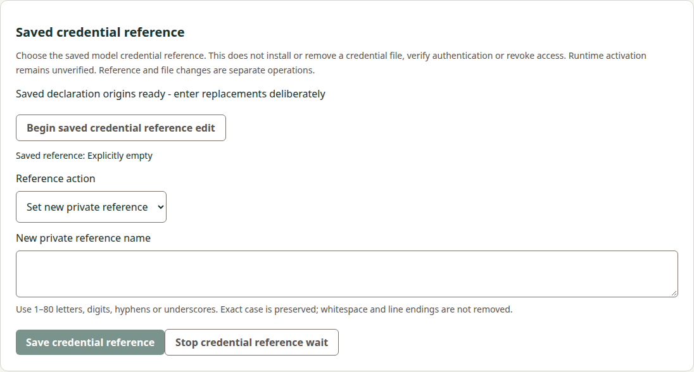
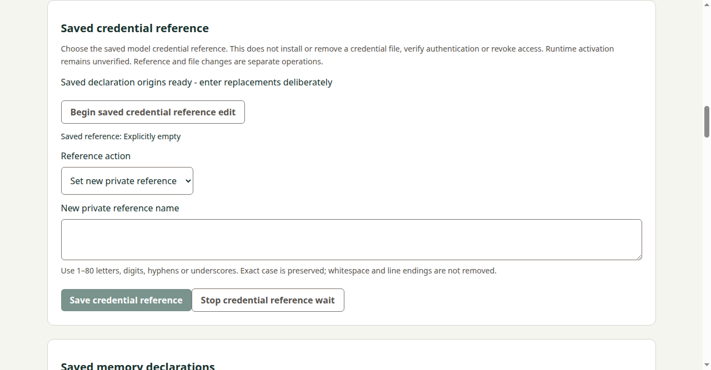

# Credential-reference consumer implementation checkpoint

## Exact pair and current state
Current independently reviewed source is [Manager39](https://github.com/s116821/ReMarkableBuddiesManager/pull/39) at3b2cb8d1d0c9801ee738fd9e578ccd37a646273b / treeaa13e7aa5ff983ac3fb616aec2b5e9c81c6c87b4. Reviewed/published [Docs107](https://github.com/s116821/ReMarkableBuddiesDocs/pull/107) baseline is0a7928db102bdedfef557a16217aebde03bbcd8f / tree49517071886b012c2b5c9b046645f813d29a6615; this final own-lifecycle Docs candidate is a normal native successor pinned in the review handoff, not that older baseline. Exact [source review5650981410](https://github.com/s116821/ReMarkableBuddiesManager/pull/39#pullrequestreview-5650981410) and [Docs review5650981721](https://github.com/s116821/ReMarkableBuddiesDocs/pull/107#pullrequestreview-5650981721) accept the repair. [Docs40311852669](https://github.com/s116821/ReMarkableBuddiesDocs/actions/runs/40311852669) passed at0a7928d.

Required [source40311864238](https://github.com/s116821/ReMarkableBuddiesManager/actions/runs/40311864238) attempt1 is fully SUCCESS at reviewed3b2cb8d: PR Title, Checks, Build, [Windows121536124453](https://github.com/s116821/ReMarkableBuddiesManager/actions/runs/40311864238/job/121536124453) and [Linux121536124794](https://github.com/s116821/ReMarkableBuddiesManager/actions/runs/40311864238/job/121536124794) all passed; Release correctly skipped on the PR. Actual CI checkout was mergee24c2b2f04039a733e4327a2622c8950f0d10b9a, exact reviewed treeaa13e7aa5ff983ac3fb616aec2b5e9c81c6c87b4, parentsb59/3b. Root independently verified both full logs, current development/source/retained-browser/packaged-Electron credential flows, the development Save raw/DOM regression, all42 actual factory controls and preserved upload bytes. Windows raw log73889bytes/SHA256ec6a6b89af22c3d005c541ffcfc5abb5e4eb833d3a2c49b9aa593cb19ce0b67a; Linux raw evidence/manifest is retained with Root's exact-source receipt. This lane did not download/execute hosted archives or replay source qualification. Existing explicit host-specific fixture limits remain; no native tablet/USB/provider qualification is inferred.

This own canonical sync/archive records a qualified bounded implementation. Root remains sole final reviewer/publisher/merger and actual-main/release observer. Final exact paired lifecycle review/current final Docs CI, normal Docs-first merge and actual merged trees/main/new tag/provenance remain pending. WholeREM42/MVP remains In Progress.

Original accepted precode is Docsa6d527db748099ee893352d96768b374c84fc9c2 / tree22a82a1c6e77ec05a216fc52a71216c8472c8b2d, [review5650583221](https://github.com/s116821/ReMarkableBuddiesDocs/pull/107#pullrequestreview-5650583221); Docs40307361816 passed before source work. Original0584f31c4bc823fc8baff71971d07d0880998a43 / tree565707e1603ff2e95733738dbb8f290a85d2f9ba was based on actualb59cf6060979e57df27b3b970a8e91eff9988c4f. Original Docs2553e66 and memory-peer finding/repair evidence below remain attributed to their actual revisions. Manager stays exactly reviewed3b2cb8d; no source change/check/replay follows from this preparation.

## Initial058 implementation boundary (memory omission corrected below)
Dedicated optional credentialReference public capability, singular strict change protocol, fixed private wired transport and separate browser POST/main-frame IPC preserve all existing APIs. Exact ASCII/case name grammar is private; current state exposes only saved reference origin/presence. Original file/path/private-change/target binding, producer-only no-op, one apply within the original budget and eight hash-only originals reuse the established pattern. Unresolved followed by cancellation/failed/late status returns unknown/null-report retaining last unresolved original. Every result keeps runtime unverified; no file operation, auth/revocation/implicit two-file transaction or provider activity follows.

Seven actual coordinators share one owner in both factories and combined memory/research/reference fixtures. Existing six-lane test helper is renamed/extended to seven without adding generic production infrastructure. Actual HTTP/source Electron/packaged Electron42-direction tests and synthetic actual-coordinator42 Busy checks cover shared ownership. Old targeted forget cancel and old reference cancel/status during newer save preserve original/token/generation ownership; current peer memory uncertainty remains retained after reference save and later refusal. There is no credential-file consumer/registry in this baseline and none is fabricated. Manual/external file originals remain independently authoritative when a reference-induced Config change makes them stale.

Shared UI preserves other sections and query/Reader/Writer drafts. Synchronous private draft/actual textarea clearing precedes Save await, choice changes and invalidation boundaries; cyclic/BigInt/arity/main-frame refusals remain sanitized. Existing ready editor setup explicitly ends the old lifecycle before a fresh Begin, retaining the corrected fresh-reference regression rather than relying on repeated old ready text. New controller checks cover exact CRLF/whitespace refusal, original reload/status, repeated Begin and stale status/Stop/retained callbacks.

## Initial058 local qualification (preserved attribution)
- Current full Node suite314 PASS,0 failed/skipped/cancelled. Dedicated initial coordinator/HTTP/child set14 PASS, controller6 PASS; existing memory/research Node peer subset23 PASS. Existing historical report parsers ran only as ordinary Node regressions; no producer executable or source corpus capture was replayed or requalified.
- Newly constructed Python reference transport suite9 PASS, including local synthetic socketpair SSH channels, fixed selectors/exact stdin, report/request caps/duplicates/UTF8/private failure output, budgets/boot/connection and single-result completion. These are synthetic peers, not native tablet/USB evidence.
- ESLint, corrected development build, production build and ordinary Linux x64 package creation PASS. Initial development build failed because new CREDENTIAL_KEYS lacked its TypeScript declaration; original failure log is retained, declaration corrected, subsequent builds passed. No production runtime defect is inferred from that incomplete local construction.
- Current development browser/source Electron and retained production browser/packaged Electron reference flows PASS: private exact name, invalid line endings not trimmed, runtime-unverified saved result, actual input erasure, peer invalidation, Stop/unknown/reload/original status and actual main-frame IPC/privacy/arity. Both actual Electron factories pass all42 directions. Current memory and research source/browser regressions PASS. Existing ordinary CI jobs now add reference Python/source/retained checks on both OS without new resources or changed release/audit gates.
- Four current390/1280 development browser/source Electron captures below were visually inspected: complete labels/controls, empty private textarea, disabled invalid Save and no horizontal overflow. Retained execution logs are separate from these source captures.

Builds/packages were produced from explicit dirty composition before native0584 freeze; generated build-info records that actual local development state. They are not immutable clean-checkout/official/current-head hosted artifacts or upload-byte qualification. Native source pins and log attribution are separate. Required ordinary both-OS full source/retained qualification and independent implementation review remain pending. No Windows/local native USB/device/provider/real credential qualification is inferred.

## Preservation and remaining gates
All13 protected delivered paths were compared byte-exact to actualb59: strict-json/quarantine, memory/research coordinators/protocols, four export/forget clock/reload paths, package-lock and audited Python/uploader locks. No producer/SDK/backend/dependency/source-maintained version/release recipe change. Existing Windows wired PR8 and Main handwriting/backend work stay outside this scope. The accepted producer vectors are unchanged; neither report corpora nor executable captures are newly minted here.

Independent exact implementation review/publication, ordinary current both-OS CI and upload-byte identity, any proven repair, own canonical sync/archive and final paired current-main review remain required before normal Docs-first merge and actual-main/tag/provenance observation. The change remains active; planned acceptance controls are not automatically marked executed by this checkpoint. Whole REM42/MVP stays open. Root alone publishes/merges; no reauthentication gate, new worker/worktree/resources/settings or tablet/RE action.

Source basis: exact accepted public precode/current source, current local synthetic command/HTTP/IPC/UI outputs, visual inspection and native preservation proof. Hosted future results are unverified.

## Independent review finding and narrow memory-peer repair

Root's independent exact0584/2553 review found a genuine production privacy defect in App.beginSavedMemory/saveMemorySettings/checkMemorySettings: their peer-clearing lists omitted credentialController.clear(). ConnectionController.pause only stops/cancels and emits no state update. Thus host invalidation correctly revoked the reference grant while a ready renderer could still retain/show the private name. Initial model/research boundary checks did not cover the memory boundary; their passes are preserved, not claimed as evidence against this finding.

Before source repair, a new actual development-browser regression entered a synthetic credential canary and clicked Begin saved memory edit. Its same-turn actual textarea erasure assertion failed on original058. The original red memory-peer-original-red.log (678bytes) is retained separately. This is a reproduced production defect, not a timing/setup failure or hypothetical concern.

Normal source successor3b2cb8d changes only src/app.ts and tests/credential-reference-hosts.mjs. Exactly three missing clear calls are added after admission/peer-Busy guards and before the first await in memory begin/save/status. No host protocol, backend, producer, locks, dependencies, workflow or release changes. Original source/captures/history remain intact.

Focused actual-UI controls now prove same-turn credential textarea clearing on memory Begin and original-memory status in development browser/source Electron and retained browser/packaged Electron. They also preserve an older unknown credential original across a new ready editor/memory acquisition, a refused memory original across credential clearing, and unrelated query drafts. The memory Save entry handler is additionally exercised through the actual development Angular component with no current memory grant, asserting both actual DOM and raw private draft empty in the same turn; the development-browser test explicitly requires that component hook so this case cannot silently skip. Production Electron checks use ordinary buttons for Begin/status; no development hook or extra API is added to the product.

Affected checks PASS: ordinary development/production builds, Linux package creation and ESLint; final memory-peer-final-source.log and memory-peer-final-retained.log cover current reference browser/source/retained/packaged flows and both actual Electron42-pair matrices. Existing memory source/retained browser/Electron flows pass separately in memory-peer-existing-source/retained.log. The initial affected-flow green logs precede an extra test guard making development Save coverage mandatory; both affected reference flows were then rerun and pass with the explicit Save handler message. Earlier314Node/9Python/module controls stay attributed to058, whose unchanged pure modules they qualified; no unnecessary broad replay or new producer execution was performed.

Local builds/package were generated from dirty058 plus this explicit repair before native3b2c freeze, with exact build-info retained in the successor evidence. They are not clean-checkout/official/hosted both-OS/upload-byte qualification. Unchanged initial screenshots are deliberately not recopied: the repair changes clearing behavior, not layout. All accepted precode artifacts and four initial captures remain byte-exact. This successor awaits Root independent exact review/publication and ordinary current CI; own canonical sync/archive and delivery remain open.

## Historical final lifecycle preparation (before CI receipt)

Prepared only the owned3requirements/6scenarios canonical body and13-file archive map outside the tracked OpenSpec tree, pending Root's actual source40311864238 receipt. No canonical file has been created and the active change has not been moved. The existing Manager manual docs/credential-reference.md and README pointer are part of reviewed3b2cb8d; final canonical Purpose will link that single native manual and complete archived contract, rather than maintain a duplicate central user guide. Relative producer links will be adjusted for the archive depth and verified before any final freeze. Fail-fast full relative-link and unchanged-path validation is required before any final freeze.

When actual qualification passes, record exact jobs/source/build attribution separately from local dirty058/repair evidence, apply only this unit's canonical sync/archive, run warranted current Docs checks and preservation/link proof, then freeze a normal native successor for Root final exact paired review/current Docs CI. Final merge/actual-main/tag/provenance remain future observations. Broad REM42/MVP stays In Progress.

## Completed own canonical/manual sync and archive

After Root supplied the actual current qualification receipt, applied exactly the accepted3requirements/6scenarios canonical body and moved only13 own artifacts to2026-10-26-edit-saved-credential-reference-companion using the client date. Canonical Purpose links the complete archived consumer contract and single native Manager manual; no duplicate central manual or Manager source edit. Contract changes only its phase explanation and two archive-relative producer links; accepted public/private normative interfaces remain exact. All original vectors, delta, proposal/design/acceptance, metadata and four058 captures remain unchanged, with genuine initial missing-delta/type-declaration/privacy-red failures retained separately.

Tasks3.1–3.3 now record independent reviewed implementation/current required hosted qualification and own lifecycle. Task3.4 remains an external final paired review/actual delivery observation, intentionally unchecked. Archival does not claim merge/publication or broader REM42 completion. Final native preservation/link proof and warranted Docs validation accompany the handoff; no duplicate source run/watch, new worker/worktree/resources/settings/auth or device/provider/credential-file/SDK/backend/RE action.
