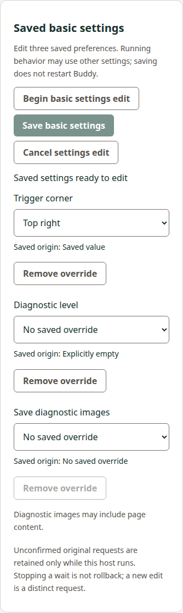
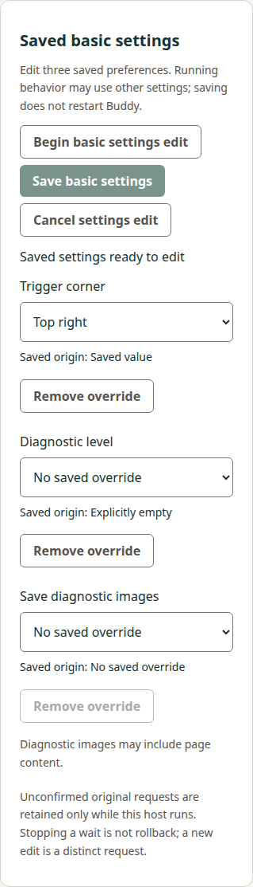

# Shared basic-settings consumer evidence

Source basis: actual Manager32 `084b3aa127f69dedf5b0a70edae04aace04ae930` (product bytes identical to initial68c467a; the successor adds only six helper late-read assertions), original
actual base `f43627ba9fef4054ae2548823698f27f630bfad6`, accepted own precode
`4cac5c3e721ab97270fcd3d706f3b900b4803f8d`/review5587743737, accepted producer82717f
and original captured corpus. This is an active implemented candidate, not merged,
archived or broad REM42/runtime qualification. No tablet/provider/credential/trust
or package execution occurred; local UI uses the installed source Electron runtime.

## Implementation and ownership

The protected optional host method, fixed HTTP/main-frame IPC adapters, strict raw/
reduced validation, fixed Python selectors and shared three-field UI are implemented.
The general saved view still discards its digest and grants no edit authority.
Finite changes preserve omission/null origins; only dirty fields are sent. Internal
prepare and at most one original apply share one13s budget. Original exact private
prepare/input bytes and integrity hashes are retained before possible dispatch.
A120s ready grant and one active/eight unresolved bounds do not evict unknown evidence.

A single private I/O token spans Begin, Save, remote original status and direct
forget prepare/confirm/receipt. Busy acquisition cannot cancel/hook another owner.
Acquired old status invalidates a merely ready editor before I/O. Both coordinators'
targeted cancel checks lane/reference/token; old forget cancellation cannot reach a
new basic apply or invalidate it through a hook. Raw observer receiver stays original;
external wrapped maintenance (including raw run), real navigation and explicit
refresh revoke ready/pending authority. Finally releases only the original token.
Unknown forget/status packets remain unchanged; no automatic retry, service call or
file fallback is introduced. The public UI never displays private hashes or intent.

## Original report compatibility versus synthetic faults

Original45report artifact is byte-identical101745bytes SHA256
`8adbd87c292d886a9aceed52e701cb1941ca8abc8c1671ac187446d32b375b10` from Buddy61685ea.
Capture remains source87bc8d4/executableed2f34f; all45stdout and27present-stdin hashes
plus separately attributed before-shape stdout hash verify. Original general35corpus
is untouched. No producer executable or old version was replayed.

All38basic reports cross the strict private parser and actual shared coordinator/
controller; seven general reports cross their existing saved-configuration controller.
Surrounding phase reports use original attributed specimens. Accepted prepare/status
paths needing retained uncertainty use separately labelled synthetic apply-response
loss; this is not an induced-loss claim for the original producer execution. The
native no-op input is intentionally injected as redundant dirty keys into the test
controller to cover its defensive no-change response; normal UI gestures filter such
redundancy. Its original byte/status proof remains attributed to the captured case.
A full original inspect/prepare/verified-apply sequence also crosses the coordinator/
controller with exact original intent linkage and no private fields in public state.

## Executed local controls

- All196Node tests pass (176base plus20new), including all report compatibility,
  field/origin/patch rejection, private/public phase consistency, actual bounded
  child stdin/identity/cap/nonzero/timeout, original packet retention, deadline,
  capacity, no-repeat, remote-status ownership and cross-coordinator cancellation.
- Seven Python controls pass. Actual local SSH channels exercise all four exact fixed
  selectors with original stdin or no stdin and exit0/2/127; identity samples/route/
  notifications are fixtures. Duplicate/UTF8/framing/input/output/stderr bounds,
  before/after identity change, timeout/close and one-output custody controls pass.
  This is local SSH evidence, not native USB or Windows device qualification.
- Lint and both development/production builds pass. All10existing workflow graph
  controls pass; only commands in existing jobs change. No job/dependency/lockfile,
  SDK, release/version graph or source-maintained own version changes.
- Actual development browser HTTP and source Electron pass full UI/host fixtures:
  finite set/clear and declared-null removal, displayed original value, both widths,
  verified saved file versus runtime, lost reply/reload host-only recovery, no auto
  status/reapply, exact old forget receipt bytes, old forget/basic cancel versus new
  apply, old status busy versus active Save and invalidation of ready, pre/post-apply
  cancellation, stale callbacks and real Electron arity/sender/main-frame refusals.
  Only lower transport/reports are synthetic; actual public guards remain installed.
- Actual HTTP controls independently reject wrong origin/session/query/request shape,
  cap/UTF8/duplicate/private input, document/resource/iframe lifetime and final bridge
  after-await generation. Source helper/main always check final public ready state.

## Corrections retained with honest attribution

Initial shared-token integration exposed an existing late-preparation regression:
direct invalidation did not release its OWN old token, leaving the next slot busy.
The correction conditionally releases that old owner only; original late/new-preview
assertions pass unchanged. Initial privacy test reused the public connection digest
as a private synthetic digest; distinct private sentinels corrected that fixture
without weakening absence assertions. Initial Python cap assertion expected
reserialized rather than padded original bytes; it now verifies exact retained bytes.
Failed native logs remain separately retained in the shared workspace.

Visual inspection caught dynamic select initialization showing the empty option
despite an actual saved corner. Binding selected options and an explicit UR assertion
corrected the product defect. Native390capture initially clipped its footer because
virtual/native heights differed; matching both heights now retains the complete
panel. Final390/1280browser and native Electron captures were inspected for correct
values/origins, readable controls/disclosure, disabled styling and no horizontal
scroll/private strings. These final images replace neither prior failure evidence
nor a retained-package/physical qualification claim.

## Scope and remaining gates

Source29paths (13existing/16new) preserve180unrelated entries from actualf436 base.
Dependency lockfile, original producer corpus bytes, current other capabilities and
all source release-version machinery remain unchanged. Docs expands only the
preserved companion's owned artifacts; original2requirements/4scenarios remain in
its5requirements/14scenarios. No producer or prior inspection ownership is altered.

Current exact-head ordinary Linux/Windows development and retained browser/Electron
package checks, independent implementation review, own canonical sync/archive and
final composed delivery remain open. Actual merged trees/mainCI/tag/provenance will
be observed separately afterward. No local package rebuild, new worker/chat/worktree
or tablet contact was used. The previous inspection publication watch is complete
and is not replayed for this increment.
