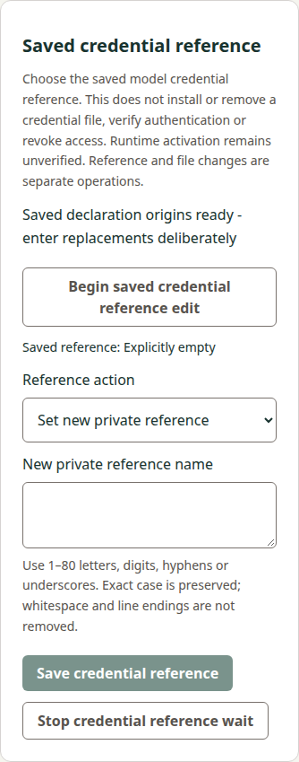
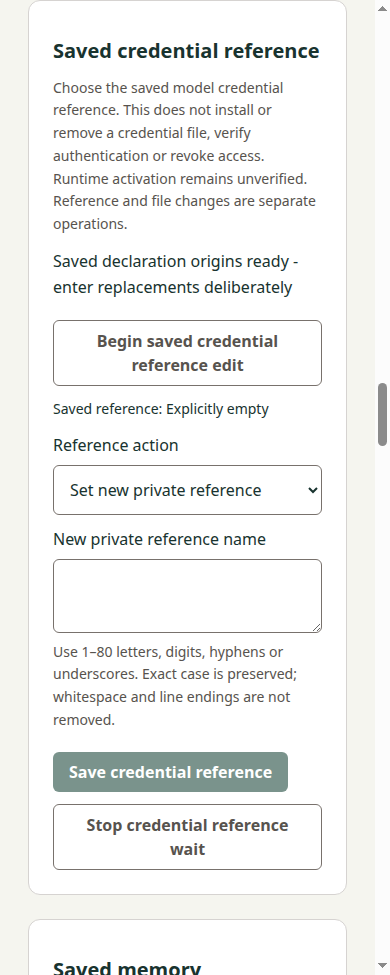

# Credential-reference consumer implementation checkpoint

## Exact pair and current state
Accepted precode: Docs a6d527db748099ee893352d96768b374c84fc9c2, tree22a82a1c6e77ec05a216fc52a71216c8472c8b2d, [independent review5650583221](https://github.com/s116821/ReMarkableBuddiesDocs/pull/107#pullrequestreview-5650583221). Published Docs40307361816 passed before source work. Current local Manager0584f31c4bc823fc8baff71971d07d0880998a43 / tree565707e1603ff2e95733738dbb8f290a85d2f9ba / sole parent actual mainb59cf6060979e57df27b3b970a8e91eff9988c4f. This Docs successor records that candidate without changing the accepted contract/delta/vectors. Root owns exact native publication/independent review. No hosted feature qualification or delivery is yet claimed.

## Implemented boundary
Dedicated optional credentialReference public capability, singular strict change protocol, fixed private wired transport and separate browser POST/main-frame IPC preserve all existing APIs. Exact ASCII/case name grammar is private; current state exposes only saved reference origin/presence. Original file/path/private-change/target binding, producer-only no-op, one apply within the original budget and eight hash-only originals reuse the established pattern. Unresolved followed by cancellation/failed/late status returns unknown/null-report retaining last unresolved original. Every result keeps runtime unverified; no file operation, auth/revocation/implicit two-file transaction or provider activity follows.

Seven actual coordinators share one owner in both factories and combined memory/research/reference fixtures. Existing six-lane test helper is renamed/extended to seven without adding generic production infrastructure. Actual HTTP/source Electron/packaged Electron42-direction tests and synthetic actual-coordinator42 Busy checks cover shared ownership. Old targeted forget cancel and old reference cancel/status during newer save preserve original/token/generation ownership; current peer memory uncertainty remains retained after reference save and later refusal. There is no credential-file consumer/registry in this baseline and none is fabricated. Manual/external file originals remain independently authoritative when a reference-induced Config change makes them stale.

Shared UI preserves other sections and query/Reader/Writer drafts. Synchronous private draft/actual textarea clearing precedes Save await, choice changes and invalidation boundaries; cyclic/BigInt/arity/main-frame refusals remain sanitized. Existing ready editor setup explicitly ends the old lifecycle before a fresh Begin, retaining the corrected fresh-reference regression rather than relying on repeated old ready text. New controller checks cover exact CRLF/whitespace refusal, original reload/status, repeated Begin and stale status/Stop/retained callbacks.

## Local qualification actually performed
- Current full Node suite314 PASS,0 failed/skipped/cancelled. Dedicated initial coordinator/HTTP/child set14 PASS, controller6 PASS; existing memory/research Node peer subset23 PASS. Existing historical report parsers ran only as ordinary Node regressions; no producer executable or source corpus capture was replayed or requalified.
- Newly constructed Python reference transport suite9 PASS, including local synthetic socketpair SSH channels, fixed selectors/exact stdin, report/request caps/duplicates/UTF8/private failure output, budgets/boot/connection and single-result completion. These are synthetic peers, not native tablet/USB evidence.
- ESLint, corrected development build, production build and ordinary Linux x64 package creation PASS. Initial development build failed because new CREDENTIAL_KEYS lacked its TypeScript declaration; original failure log is retained, declaration corrected, subsequent builds passed. No production runtime defect is inferred from that incomplete local construction.
- Current development browser/source Electron and retained production browser/packaged Electron reference flows PASS: private exact name, invalid line endings not trimmed, runtime-unverified saved result, actual input erasure, peer invalidation, Stop/unknown/reload/original status and actual main-frame IPC/privacy/arity. Both actual Electron factories pass all42 directions. Current memory and research source/browser regressions PASS. Existing ordinary CI jobs now add reference Python/source/retained checks on both OS without new resources or changed release/audit gates.
- Four current390/1280 development browser/source Electron captures below were visually inspected: complete labels/controls, empty private textarea, disabled invalid Save and no horizontal overflow. Retained execution logs are separate from these source captures.

Builds/packages were produced from explicit dirty composition before native0584 freeze; generated build-info records that actual local development state. They are not immutable clean-checkout/official/current-head hosted artifacts or upload-byte qualification. Native source pins and log attribution are separate. Required ordinary both-OS full source/retained qualification and independent implementation review remain pending. No Windows/local native USB/device/provider/real credential qualification is inferred.

## Preservation and remaining gates
All13 protected delivered paths were compared byte-exact to actualb59: strict-json/quarantine, memory/research coordinators/protocols, four export/forget clock/reload paths, package-lock and audited Python/uploader locks. No producer/SDK/backend/dependency/source-maintained version/release recipe change. Existing Windows wired PR8 and Main handwriting/backend work stay outside this scope. The accepted producer vectors are unchanged; neither report corpora nor executable captures are newly minted here.

Independent exact implementation review/publication, ordinary current both-OS CI and upload-byte identity, any proven repair, own canonical sync/archive and final paired current-main review remain required before normal Docs-first merge and actual-main/tag/provenance observation. The change remains active; planned acceptance controls are not automatically marked executed by this checkpoint. Whole REM42/MVP stays open. Root alone publishes/merges; no reauthentication gate, new worker/worktree/resources/settings or tablet/RE action.

Source basis: exact accepted public precode/current source, current local synthetic command/HTTP/IPC/UI outputs, visual inspection and native preservation proof. Hosted future results are unverified.
