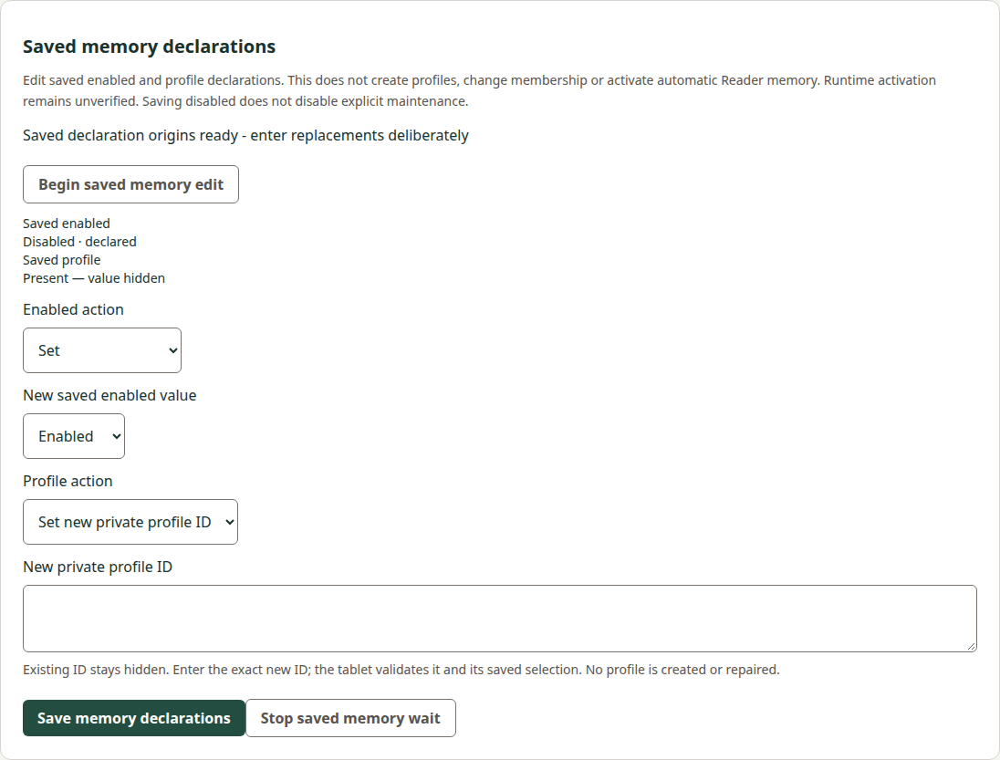
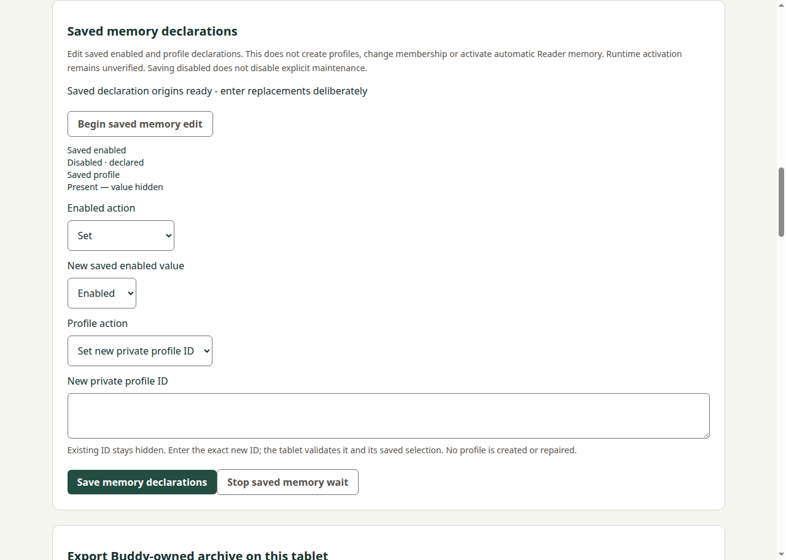
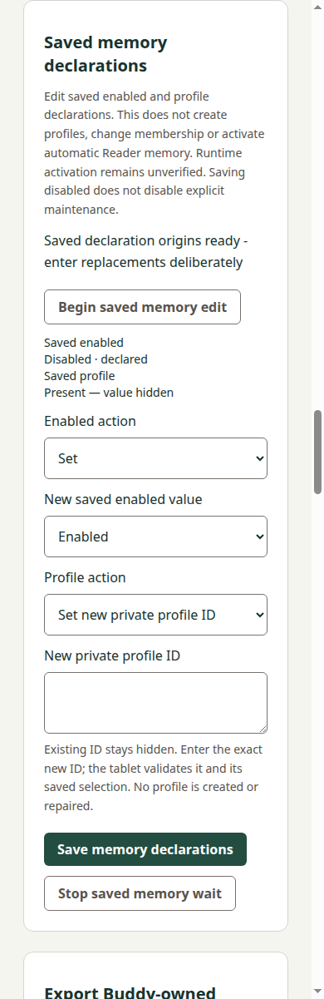
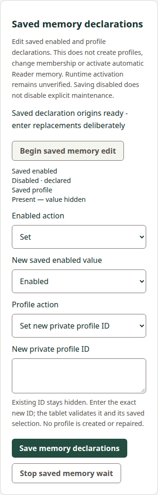

# Saved-memory consumer verification checkpoint

## Current reviewed pair and delivery state

Current candidate for [Manager38](https://github.com/s116821/ReMarkableBuddiesManager/pull/38): `bd3baac03c832c5699d7fbcabf1fb1c8588f572e`, tree `a5b3ea6f1b25daa7530ac1fcf57ea15030b4e716`, sole parent reviewed56ded80. Only the two memory UI/controller test files change; every production file remains exact to56ded80, which normally composed preserved0240 and actual mainf8b0aaf. Paired [Docs83](https://github.com/s116821/ReMarkableBuddiesDocs/pull/83) review candidate is `e8b1004795dcd3334a86446784dd197bbdf682d2`, tree `c8cc59cc8488a080ecac526b5dc0c87b8b4b70b9`, following accepted continuation precodeb891827. This Docs successor preserves the prepared status correction and adds the failed-CI investigation below. The previous56ded80/e8b1004 pair remains the independent review baseline; the test successor awaits exact review/publication.

Root independently reviewed this exact source/UI/evidence pair and reported no blocking source finding, with its review posted on Manager38. [Docs40265373840](https://github.com/s116821/ReMarkableBuddiesDocs/actions/runs/40265373840) passed. [Manager40265376525](https://github.com/s116821/ReMarkableBuddiesManager/actions/runs/40265376525) passed Title/Checks/Build but both OS integration jobs FAILED in the repeated memory editor setup. That attempt is closed and remains failed; no unchanged rerun or upload-byte qualification is credited. Root is the sole CI observer and normal publisher. Current full both-OS integration/upload-byte qualification, own canonical sync/archive, final paired lifecycle review and actual delivery/publication remain pending. No additional build, auth retry or release watch follows from this correction.

The historical0240/five-lane/precode sections below retain their original evidence and limits. They describe previous checkpoints, not the current candidate. Current six-lane implementation and local evidence appear under "Current implementation continuation on actual main" below. Original failures/captures remain intact and are not recredited.

## Historical original precode and0240 delivery checkpoint

Accepted concrete precode: Docs `61d4ae5cf895fe1ebc426db0c057a768562be7e9`, independently accepted in [review5622256281](https://github.com/s116821/ReMarkableBuddiesDocs/pull/83#pullrequestreview-5622256281) before API/source edits. Original implementation: Manager `0240bb073ff77049d117c1d8cab480990654cd1c`, based on actual main `0983fed62a547d4fb1f01ff209a8aa7423d60a8e`. Source is committed locally; its push failed when the existing GitHub credential became invalid. No feature implementation PR or hosted feature run is claimed yet.

The separate test-only correction [Manager36](https://github.com/s116821/ReMarkableBuddiesManager/pull/36) stays unchanged at `c4b52f4f9f7b4f993784c219126b3e254c6af048` for independent review. This feature has not speculatively composed that unmerged branch. Compose its actual merged main before ordinary feature CI. Earlier actual-main/test failures remain failed and separately attributed; no historical failure is relabeled.

## Historical0240 completeness and contract mapping

| Requirement/scenario | Implementation and local evidence |
| --- | --- |
| Explicit Keep/Set/Clear nested declarations | Separate protocol/coordinator, controller and fixture suites cover Boolean/profile types, origin/presence views, parent/no-op and at-most-once apply. Profile grammar remains producer-owned; exact spelling is preserved. |
| Invalid/stale conditions | Fixed POSIX path digest before ready; strict duplicate/shape/UTF8/framing/caps; original operation/base/patch/target/after-view linkage; boot/connection identity, timeout and expiry controls. |
| Private submission/invalidation | Controller generation/draft tests and both actual source renderers check synchronous DOM/draft clearing on Save, pagehide, observation, other maintenance, Stop, expiry and destruction. Late completions cannot refill or clear a newer editor. Circular/BigInt invalid requests emit a static error rather than private property names. |
| Original possible-publication reconciliation | Host retains at most eight hash-only intents without eviction, raw patch retention, automatic retry or reapply. Tests cover uncertain status, original reference binding, unavailable refusal, reload, Stop and later desired-file observation. |
| Saved-only authority | Every parsed report requires runtime unverified; both rendered hosts display saved declarations and explicitly leave runtime/automatic Reader activation unverified. Existing profile ID is hidden. Saved disable does not disable explicit maintenance. |
| Five-lane custody | Actual model/basic/forget/export/memory coordinators cover all20 directed invalidations, Busy without hooks/cancel/I/O, stale cancellation and token/generation ownership. Existing Reader/Writer/selected query drafts are preserved. |
| Attributed complete lifecycle | Original corpus/parser and synthetic transport/UI evidence are separate below. Hosted retained qualification, independent implementation/final review and own sync/archive/delivery are still outstanding. |

Three requirements/seven scenarios are mapped. Tasks2.1–2.3 and3.1–3.2 are locally complete. Task3.3 remains open for ordinary both-OS retained artifact checks;3.4 and3.5 remain open for review, own canonical lifecycle and actual delivery/publication. This checkpoint is not ready for archival.

## Historical0240 verification actually performed

- Node24.21.0: ESLint, development and production Angular builds pass at the current source revision. Full Node run: **263 passed, zero failed/skipped/cancelled**.
- Nine Python transport groups pass, including twelve real local socketpair SSH selector/exit cases. These are synthetic local peers, never a tablet. Actual supervised-child tests independently exercise private response handling, cancellation and finite output.
- Current guarded development-browser and source-Electron flow passes: Boolean/profile save, exact private input, same-stack DOM clearing, hidden existing ID, preserved query/Reader/Writer data, Stop/unknown/reload and read-only original status. Actual main-frame IPC, arity and cyclic-input privacy refusal pass. HTTP origin/query/duplicate-member/size guards pass.
- Existing source model and wired/preload inventory regressions pass separately. Ten workflow controls pass; existing both-OS integration jobs add the new source and retained memory suite without new resources/jobs or audit relaxation.
- Four current captures below were inspected. Narrow/wide panels are complete and readable, the private input is empty, controls remain inside the viewport and there is no horizontal overflow. Native capture uses the full actual viewport plus a panel-bounds assertion; an earlier cropped capture and mixed-generated-output attempt are not qualification.

No local retained package build/execution was performed. Ordinary hosted retained-browser/packaged-Electron checks and upload-byte identity are pending. No producer replay or tablet/provider/real-credential/service operation occurred.

## Immutable historical input versus synthetic evidence

The original Windows-host corpus is copied byte-for-byte to `tests/fixtures/memory-settings-093bf45-corpus.json`:173578bytes, SHA256 `727c8031adc41d3f8f93b435706c5ade7324ad8055c980b2ce76f9b0d3d2552b`, capture source `093bf450b35cede5ae01386d872b198072873bbf`, executable `db7e3bbbfdc8dfc62de6386099bb001ec0fb21f409c11718846f377da1300485`. The new parser consumes all90 original reports and verifies all160 raw stream/input hashes without producer execution. Historical Windows path hashes never grant POSIX editor authority.

The independent mixed Boolean/uppercase-profile vector is115 canonical/163 prefixed UTF8 bytes, SHA256 `eb760e429bd11cdebf432a7dbb2f43588474e78112b042d244fd671d188dec0d`. Tests verify reordered/escaped equivalence and spelling distinction without introducing a profile UUID grammar. Synthetic fixed-POSIX reports are separately constructed; original streams remain unchanged. Delivered producer `7f07169faef2a2e5ec6761412034c012cc37d9f4`/v0.24.0 and its closed publication are not replayed or reopened.

## Historical0240 scope and reproducibility

Against actual Manager0983, exactly14 existing paths change and16 are added; all230 other baseline entries are unchanged. Product integration is additive in observer/browser/IPC/Angular, with separate new protocol/coordinator/transport/controller. The old quarantine strictJSON scanner body is mechanically identical after extraction into a pure shared module. No dependency, maintained source version, release contract, producer source or older API cap changes.

Public component checks: `npm run lint`, `npm test`, `npm run build:development`, `npm run build`, Python `-m unittest discover -s tests/memory_settings -v`, and `npm run test:memory-settings-hosts` under an offscreen display on Linux. Existing CI runs the same new suite with `--packaged` against frozen downloaded artifacts on Windows and Linux. Source and retained results must stay separately attributed.

Local log receipts are recorded below. They are workspace evidence, not externally hosted downloads or proof of Windows/retained execution.

| Local log | Bytes | SHA256 |
| --- | ---: | --- |
| `current-node-tests.log` | 38796 | `a70cae9be9616424accaff271d7dd207df1629d8040d37ba67b38b2f4573095c` |
| `current-build-dev.log` | 592 | `40377cd394abe022412080f98feed37990294d30f1a07467d9be8e0e25290b70` |
| `current-build-prod.log` | 631 | `b8ecc47890a86a21395efbcdad4a1c2e24016871bb177f1c160d13f1b64a8f19` |
| `ui-final-source.log` | 308 | `4d8d610fb24b5b99ec3991c1959b25c31193c82aa828688ecdd0c27ab8ea3879` |
| `transport-first.log` | 1557 | `20eda0d70566716d1ba106e8fcc9ad2c28ff6f769c77976a06c63460caf2a5f8` |
| `model-regression.log` | 308 | `82086057d6a1cf3d7ac808222ccec0a3eb15def8b5292cb0b2b9c2beb33f8e53` |
| `wired-regression.log` | 118 | `f467ed0d39eee16d3caddcac46e37e97a27ee457b91de826009506176e77cc9d` |
| `workflow-controls.log` | 1051 | `a2dfff39df3a8a27047ac500f33ce436e60c8e3425c4785775c2d5128b53591f` |

## Original source captures (historical0240)

## Remaining gates

Exact continuation precode b891827 is accepted, and current local composition/repair56ded80 has received independent source/UI/evidence review with no blocking source finding. Root owns normal native publication with its existing valid account; no SCRAPPY authentication retry is required. Ordinary current both-OS source/retained CI remains required before own canonical sync/archive, final exact paired review, normal Docs-first delivery and actual merged trees/main/new tag/provenance. Broader backend setup/provider/runtime/native/installer/MVP acceptance remains outside this bounded delivery.

Source basis: accepted public contract/review, current source files, original captured corpus and local command/render outputs. Pending outcomes are explicitly unverified; no hardware or runtime inference is promoted to a verified result.

## Historical continuation precode after actual research delivery

Normal read-only inventory establishes actual Manager f8b0aaf209d1c976b8e47781be5a999ff63f7e0c / Docs a14df94c72eef4f4ec05590770b676a4681a4c56. Both actual trees match the separately reviewed research delivery; its actual-main/new release observation remains Root-owned and is not duplicated. Preserved memory source0240bb073ff77049d117c1d8cab480990654cd1c and Docsfa204ab60fcfbeef20dd8b3bf6fd0316916e3f49 are reachable through local refs/keep preservation refs and original history. Only Docs is composed, through a normal merge of current actual main; Manager source remains uncomposed/unrepaired at the original candidate.

Read-only tracing confirms an existing source/contract contradiction at memory host28/parser91: after status sets unresolved, cancel or failed/late status fallback can emit unresolved with null report. This precode specifies the already established original-preserving unknown/null-report fallback and real-coordinator regressions; it does not claim a runtime reproduction or completed repair. No original tests or producer corpora were replayed.

Six actual peers and30 directed pairs will replace the old five-peer/20-pair composition before delivery, preserving the actually delivered export/forget correction, identical strict-json helper, research routes/UI and audited tool locks. The proposed wire/field/cap/deadline/runtime boundary remains unchanged. The previous local263Node/9Python/source-host evidence and old captures remain historical only; they are not credited to an unimplemented composition or repair. Updated tasks re-open the affected implementation/verification work and require independent exact amendment acceptance before source repair.

The original SCRAPPY credential failure is historical. Root's existing valid account/native bundle handoff now owns ordinary publication; no credential change or auth retry is required here. Final six-lane implementation/current both-OS qualification, own canonical lifecycle/final paired review and actual normal delivery/publication remain unfinished. No saved-memory implementation or new feature is completed by this Docs-only preparation.

## Current implementation continuation on actual main

Independent review accepted exact precode Docs b891827915c4a9964ca092c31ece363308f2403d, without a new user gate. Current Manager56ded80dca1e7f0cbb9cd53148156842683df366 / tree21dd5ec681dc4fc5b37eec8aeb8fa0f63b447636 is a normal two-parent composition of preserved0240bb073ff77049d117c1d8cab480990654cd1c and actual merged mainf8b0aaf209d1c976b8e47781be5a999ff63f7e0c. Original source/Docs refs, corpus and original captures remain intact. This source candidate is published in Manager38 and has received independent source/UI/evidence review with no blocking finding. Full both-OS integration and final lifecycle/delivery remain pending; it is not a delivered feature.

Three new actual-coordinator regressions first reproduced RED on0240: after a valid unresolved observation, idle cancel, failed status and late status all threw the protocol refusal for unresolved/null-report. The minimal successor changes only #uncertain to current unknown/null-report. Focused GREEN controls retain exact reference/identity/hash-only original intent and last unresolved retained state, prove one apply, and prove idle cancel sends nothing. No new successful observation, refreshed intent, retry, repeated write, lost data or runtime activation is claimed.

Both actual host factories retain all five delivered peers plus memory, with one owner and reciprocal before-I/O invalidation. Both guarded routes/preload capabilities and strict child keys/caps remain separate. Memory/research integration fixtures now compose the same six actual coordinators through a shared synthetic memory fixture base rather than retaining a second five-lane test topology. The actual HTTP and actual source/packaged Electron factories each pass all30 directed idle-grant invalidations; synthetic real-coordinator checks additionally pass all30 Busy/no-hook/no-cancel/no-I/O combinations. Existing targeted old cancellation/token/generation controls remain green.

Shared App preserves both sections and reciprocal begin/save/status/Stop busy guards, clears the actual private memory textarea synchronously before research acquisition and other invalidation boundaries, and retains unrelated query/Reader/Writer drafts. Both editor source/retained host flows pass unknown/reload/original-status controls. The delivered export/forget correction's four files, audited filelock/Undici locks, strict-json and quarantine source are byte-exact to actualf8. The unnecessary original quarantine extraction is omitted; no dependency, producer, release recipe, version source, SDK or tablet action was added.

### Current local qualification and attribution

- Focused current Node set:46 PASS, including both editors' coordinator/controller/guarded-HTTP/bounded-child suites and new fallback/six-lane checks. No old report/corpus or producer replay; the historical263-node/corpus evidence above is not a current full-suite result.
- Python memory synthetic socketpair/transport controls:9 PASS. ESLint, development Angular build, production Angular build and ordinary Linux x64 package creation PASS.
- Final six-peer-fixture development browser/source Electron and retained production browser/packaged Electron memory controls PASS. Actual Electron30-pair controls pass in both source and packaged hosts. Delivered research source/retained UI controls PASS after fixture composition. All lower tablet transport is synthetic.
- New390/1280 browser and Electron captures below were visually inspected for clipping, visible input and control labels. Original four captures above remain unchanged. These current captures are Linux rendered-host evidence, not Windows/native/tablet evidence.
- Builds/packages were created from the explicit dirty composition before native commit56ded80; build identifiers truthfully record that local state. Final committed source and tests are pinned separately. No immutable clean-checkout, official artifact/upload-byte identity or hosted both-OS qualification is inferred from these local builds. Required ordinary CI remains unchecked.

Three retained local UI setup failures precede the successful runs: incorrect plural research status expectation; direct Electron factory calls before connection observation; and source Electron loading stale production output after only development output was built. Corrected test expectation/order and fresh ordinary production build resolve these inputs. All failure logs remain retained separately; none is overwritten or credited as a pass. The three original protocol regressions are separately retained production-source findings and were repaired as described above.

The final fixture amendment (shared six-peer base) required focused and UI checks again; final logs are continuation-focused-six-fixtures.log, continuation-lint-final.log, continuation-final-source-hosts.log, continuation-final-retained-hosts.log, continuation-final-research-source.log and continuation-final-research-retained.log. Python/build/package and original red/green logs retain distinct names. Frozen review transport pins log/capture bytes; Linear owns evolving task/review status.

Source basis: accepted public precode, exact local native source/history, synthetic command/HTTP/IPC/UI outputs and visual capture inspection. Windows/both-OS integration completion, own canonical lifecycle/final paired review and normal publication remain unverified here. Independent source/UI/evidence review is recorded in the current status above. Root separately closed research v0.22.0; no duplicate release watch was started.

## Failed both-OS CI attempt and bounded test successor

Root's retained attempt1 Linux121387314505 log is84589bytes/SHA256 `8497b3eedcfb339e6bb87e10a24591d5141fa5eafb4484c20f4fbdbe544a1956`; Windows121387314438 log SHA256 `803f40d93522d7ec3938e1d1299b9c9089ece958f960ca1f3d821b048056c146`. Root observed the API snapshot and full logs: both jobs passed prior model/basic/research source/retained flows, then failed at memory-host line20. Linux saw disabled Save for30s; Windows saw the profile textarea detach during focus. The outer step's Python-install label does not identify the actual failure. These raw receipts stay with Root; this lane did not download them or create another observer.

The original helper redundantly began another memory editor immediately after the prior stage had already made one ready, synchronizing only on identical "origins ready" text. A bounded30-repeat local run did not reproduce the hosted timing and is not used to call it a flake. A separate deterministic same-stack actual development-browser trace establishes the setup hazard: after clicking Begin, old ready DOM remained visible while the actual controller was busy/reference-null/actions-keep/invalid and ignored old-control input. After positively awaiting a different, non-null ready reference, the new editor remained actions-keep/invalid/draft-empty. This explains the observed disabled/detached input patterns without establishing a production controller defect. A fresh ordinary hosted successor must still confirm the correction.

Narrow source successorbd3baac changes only `tests/memory-settings-hosts.mjs` and `tests/memory-settings-controller.test.mjs`. The UI helper explicitly finishes an existing ready editor, waits for unique invalidated status and old Save removal, and asserts no cancellation/write before beginning fresh. It preserves repeated setup stages, reciprocal research clearing and delayed-apply/Stop/reload/status coverage; no timeout is raised. The new actual-controller regression gates repeated Begin, verifies ignored old actions/paste and a genuinely different fresh reference, then verifies fresh input succeeds. No production code, public contract, transport, dependency, workflow or captured source data changes.

Directly affected local controls: controller8 PASS (including the added case), ordinary ESLint PASS, development browser/source Electron plus retained production browser/packaged Electron memory flows PASS, and both actual Electron30-pair controls PASS. Existing locally built56 production bytes were reused because every production file is unchanged; no build or unrelated suite replay was needed. These local passes do not qualify Windows/current-head hosted integration/upload bytes.

Retained diagnostic failures are separate: a duplicate local identifier caused the initial trace SyntaxError; an initial reference predicate allowed null and is not a positive fresh-reference result. The corrected positive-reference trace is retained separately. Ordinary lint first included two ignored standalone diagnostic scripts located in test-results and failed on their browser globals/unused imports; those owned diagnostic files were moved intact into the external evidence folder and ordinary lint then passed. No lint rule/configuration or hook was bypassed. Failed hosted attempt, diagnostic inputs, outputs and initial lint log remain available with exact successor transport.

Sync/archive, current both-OS CI, independent successor/final paired lifecycle review and delivery tasks remain unchecked. Root alone reviews/publishes the successor; no tablet/provider/SDK/backend/auth action occurred.
