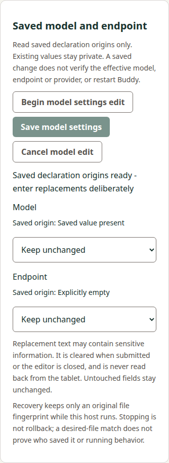
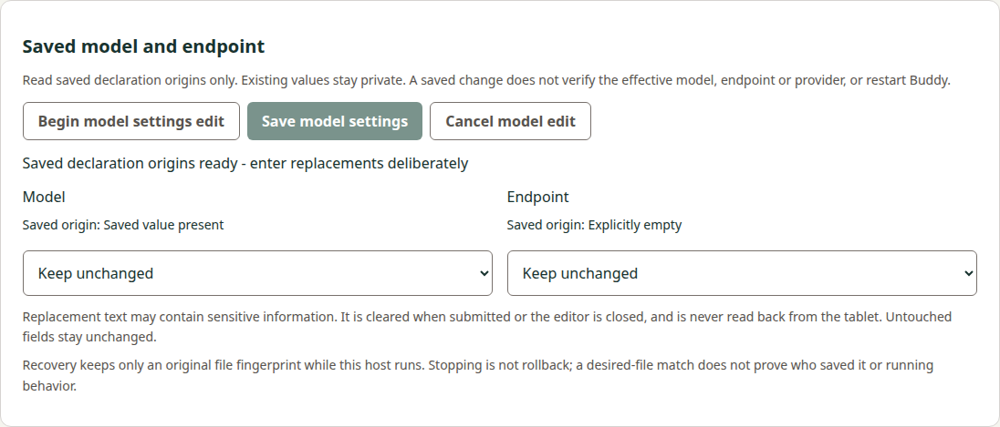

# Shared model consumer implementation evidence

Source basis: Manager33 1aa4980ea03fa784ee79f74ebba8db2a7156e8e9,
including explicit declared-null UI coverage, owned HTTP decode-buffer clearing and
the reviewed raw-newline correction after initialffaecd2; actual base8dfaf8550f64fbf84e474bce9a70ac895306e516; accepted precode
15e34308f77e3c4591d257ea34917b12a2631b6b/review5589113102 and actual
Docscc4cadf03deb285fcbbae43298a7057098f75478. This is an implemented active
candidate, not final review/archive/merge or broad/native qualification. The basic
consumer delivery/publication is closed at Manager v0.19.0 and is not replayed.
Model producer actual8c90edab/v0.22.0 is likewise a closed input. No tablet,
provider/credential/trust action or local retained-package rebuild occurred.

## Implementation and private lifetime

The optional protected modelSettings HTTP/main-frame IPC operation, separate strict
private/public model validators, fixed Python selectors and shared explicit editor
are implemented. Reads expose origin/presence only. Keep/replace/remove actions send
only deliberate fields; opaque strings preserve Unicode/CRLF/control/trailing bytes,
without URL/provider interpretation or undisclosed old-string comparison. Rust's
nonblank predicate and scalar/UTF8 bounds are explicit; U+FEFF/U+0085 differ correctly.
The16384request cap belongs only to this new path; existing API/request/wire caps
are unchanged. Safe results reject action/phase/current mismatches, including status
returning ready and model unresolved pretending a current projection exists.

Renderer raw drafts are separate from safe state, cleared before submission's first
await and on editor/local navigation/pagehide (including persisted page transitions),
refresh/disconnect/other maintenance/Stop/expiry/destroy. Paste uses the user event
only, splices raw text through normalized textarea UTF16 offsets, preserves unchanged
CRLF/lone-CR spans on later edits, and refuses ambiguous/oversized/malformed edits.
No app draft persistence/logging/auto-restore/retry or JavaScript zeroization claim.

The host snapshots its own patch, binds canonical changes_sha256 and original file/
path/operation/target, then applies once. Caller mutation cannot replace that patch.
Raw changes/prepare/apply/base64 live only in the bounded Save path; mutable owned
buffers are cleared and references dropped on all terminal/exception paths. Retained
records contain exact original hash-only prepare bytes, original {intent} status
bytes/integrity hashes and safe presence fields, NEVER a retry patch. Status has no
changes field; mismatches stay unresolved/null current and later refusals do not
settle an earlier possibly dispatched Save. Old active references cannot be reused.

All three coordinators use the existing MaintenanceIO, original observer receiver,
explicit pairwise before-I/O invalidation and token-conditional cancellation/release.
Busy runs no hook/cancel/I/O. Remote status invalidates idle ready grants; host-only
snapshots do not. Original120s ready and one13s Save budgets, remaining child/Python
bounds and corrected post-await/Stop generation/reference/original rules are retained.

## Original bytes versus synthetic surrounding phases

Original32Windows reports/60raw stdin+stdout hashes remain byte-identical in the
90529-byte model-settings-c785afe-corpus.json, SHA256
1445676ff01ad2cfebbd94ed6a33845fccf63b5630848419f4fd15584408fcfe.
Capture sourcec785afe044fcd00d386ce9030cb06916245ba2c4/executable
2a624cfd80b87a945e3b0a8a7560100a0d0c92c3d4d62c386959ac57113b8fa6 attribution
is retained; no producer binary was replayed. The independent180canonical/227prefixed
patch reference matches7b8b312e53ce731e251614648218ebf89f994b4d03b047e67278ae0b8ff2c226.
A separate serialization reference confirms maximum valid control text requests:
public Save14139, producer apply14337, private envelope19304bytes, within caps.

All32 original report streams cross the actual strict parser/coordinator/shared
controller, with matching original inspection/prepare linkage as applicable. The
invalid-input original reports are consumed under valid surrounding host requests;
that does not claim the UI can submit their rejected original malformed stdin.
Synthetic surrounding apply-response loss is explicitly labelled for prepared/status
paths needing retained context. Original status-before-apply and status-after-verified
keep those original attributions; no actual induced transport-loss claim follows.
The normal UI can submit a logically unchanged opaque replacement, so the original
no-op crosses normal explicit replacement gestures without dirty-state injection.

## Executed controls and visual inspection

- All225Node tests pass:203baseline plus22model controls. They cover all32 original
  streams, exact finite/private shapes, wrong patch/hash/phase/current/identity,
  Unicode/scalar/byte/whitespace caps, original patch mutation, hash-only status,
  deadlines/ready expiry/late completion, capacity, all3lane ownership and stale Stop.
- Nine Python controls pass, including12actual local SSH selector/exit combinations
  for inspect/prepare/apply/status with exact original stdin/no stdin. Routes,
  notices, identities and report writer are fixtures. Framing/duplicate/UTF8/cap,
  stderr/nonzero/timeout/post-identity, hash-binding/status-no-patch and one-output
  controls pass. This is local SSH evidence, not native Windows/USB qualification.
- Actual child supervision verifies exact private stdin, inclusive24576output cap,
  overcap/identity/nonzero refusal, inherited500ms timeout and invalid-budget no-spawn.
- Both actual protected development browser HTTP and source Electron UI pass exact
  CRLF/non-BMP/trailing paste plus later typing, clear/null/unchanged and saved/runtime
  disclosure, same-ID refresh/other-panel/persisted-pagehide clearing, lost reply/reload
  recovery without automatic status/reapply, pre/post-apply Stop and no input refill.
  Original old forget/receipt bytes and basic/model/forget cancellation/status owners
  survive both guarded paths. Real Electron arity/sender/main-frame guards remain.
- Actual helper additionally rejects wrong origin/session/query/duplicates/UTF8/
  body caps/private extras and final stale public projection; document/resource/iframe
  lifetime and late same-ID reads remain covered. Input/output errors do not echo text.
- Existing basic editor browser/source Electron, exhaustive wired preload inventory
  (new modelSettings included, all old members retained), and development Tailwind/
  focus/startup controls pass. Lint, development/production builds and all10unchanged
  workflow-graph controls pass. Only commands inside existing jobs were added.

The native UI harness imports the test checkout's synthetic lower-report fixture;
actual packaged/source coordinators, HTTP/IPC and public guards remain installed.
Ordinary hosted retained jobs must still execute the frozen browser/Electron artifacts
without rebuilding. Their fixture additionally checks packaged resources byte-for-byte
and the actual packaged Python refusal entry. No local package was rebuilt.

All four below are actual current source-host390/1280 captures inspected for origin
labels, keep choices, readable controls/disclosures, complete footer and no horizontal
page overflow/private text. They are presentation evidence, not device qualification.

## Implementation-review newline correction

Review5589498565 at initialffaecd2 confirmed that collapsed deletion beside equal
displayed newlines could choose the wrong raw CRLF/LF span. Before-fix regressions
reproduce both Root cases. Current1aa4980 anchors backward/forward deletion to the
recorded UTF16 caret and actual removed display span. Unanchored fallback accepts
only identical raw results across all minimal splices, refuses ambiguous/lossy
internal newline reconstruction, and leaves Save disabled on refusal.68independent
mixed CRLF/LF/loneCR/emoji caret cases and ambiguity controls pass. Adjacent loneCR+LF
is correctly treated as one CRLF display break and separately tested; the first
new regression fixture had incorrectly counted that pair as two breaks.

Actual guarded browser and source Electron keyboard controls also verify exact raw
submissions after Delete/Backspace for mixed/reverse/loneCR/non-BMP cases.225Node,
lint and both builds pass after this correction; nine Python and ten workflow graph
controls remain unchanged/passing. The source review thread is replied to but stays
open pending independent successor acceptance; remaining full review is not asserted
complete. Extra HTTP decode-buffer cleanup clears the owned concatenated byte copy
as well as incoming chunks, without claiming immutable-string erasure or changing
existing guards/caps. The two added public rows also verify explicit declared-null
removal with untouched model omitted through both real guarded hosts.

## Preserved failures and limitations

Initial corpus test wrongly decoded rejected malformed stdin even when only its
failure report was being consumed; parsing successful original requests only fixed
that fixture, without changing any original byte/hash. Initial model coordinator
used the basic envelope's lexical key order; the separate model key order was fixed.
An old-status fixture accidentally used no-change (and another already retired a
matched diagnostic); distinct unresolved originals corrected those preconditions.
All original failed logs remain in the shared workspace.

The first native UI attempt loaded stale production output after only a development
build; building the current production output resolved the absent-model-panel failure
without increasing waits or changing guards. A declaration typo in the new module's
MODEL_KEYS export was corrected. Test cleanup now releases deferred synthetic gates
and attaches rejection observers so a subsequent browser close cannot mask the
underlying assertion. These are recorded as corrections, not independent passing
runs. Later full controls and current source-host captures pass as above.

## Scope and remaining gates

Source29paths (13existing/16new) preserve196other entries from actual8df base.
Basic/general/forget protocol/coordinator/transport files, original old corpora,
dependency lockfile and tag-only release/version machinery are unchanged. Optional
new model API adds no service, file fallback, provider/prerequisite or SDK behavior.
Docs preserves all570actualcc4 entries and expands only its own active consumer.
The completed ordinary-export actual Docs013d13 must be composed normally before
final delivery, preserving all its seven artifacts; no speculative branch merge.

Current both-OS hosted development/source/retained-package checks and independent
implementation review remain open. Only after those pass: own4requirements/11scenarios
canonical synchronization/archive, final composed review and normal Docs-first linked
squash, then separate actual-tree/mainCI/tag/provenance observations. Broader backend,
credential/provider/runtime/native, ordinary data and whole REM42 remain open.
