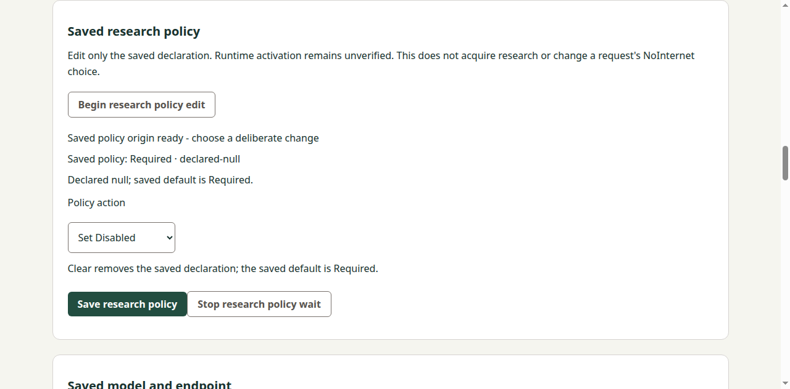
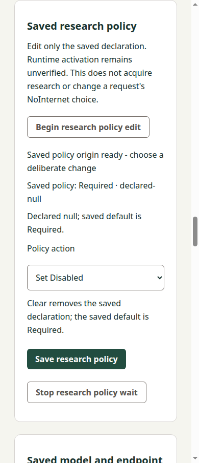

# Saved research-policy consumer local implementation

## Exact source, contract and composition

Independent concrete precode acceptance: Docs0548c73ac335bc34c9d6cfb972e82c7b868ba4f3, REM-42 review884b770b-5061-48fa-afbf-cbbe6fa03f2f. All six contents and producer inputs were independently matched; Root separately passed strict OpenSpec validation before any new Manager source edit.

Normal public read-only fetch and remote inventory established actual Manager mainb8f04d406be76a767e9b1826a2ca32e54b765f81 and Docs main11090c3a8f2cd1b1578798ab390cd757b315d0c3. The accepted proposal composed normally with current Docs in dfca455ce31868497aa046bb430e4b4b7e1122fb, preserving all six accepted file blobs at that step. Actual delivered Manager has model/basic/forget/export; research adds a fifth lane. No saved-memory implementation was silently included. Preserved independent source0240bb073ff77049d117c1d8cab480990654cd1c and Docsfa204ab60fcfbeef20dd8b3bf6fd0316916e3f49 refs/evidence remain untouched.

Local implementation is Managerd9aba631e65ef42358ccbcc827fa596b6455ac7e, tree9eafaf4cf8eda649c4cbf82447f3d5379a88b074, parentactualb8. Its28 paths are13 existing changes/15 additions;233 other base entries are exact. No Rust/backend/SDK/framework/dependency/release/version-authority change. All application versions are still minted from tags/build time. Existing CI jobs only add the bounded suite and keep upload-byte/audit gates.

## Requirement and scenario mapping

| Requirement/scenario | Native implementation and meaningful local evidence |
| --- | --- |
| Separate explicit saved edit | Separate research-settings protocol/coordinator/transport/controller and guarded routes. Synthetic tests exercise all4 original declaration states ×3 actions, exact origin transitions, unchanged unrelated Reader/Writer values and producer no-op apply count. Clear removes; setting required from absent/null remains a real declaration change. |
| Invalid/stale/unsupported conditions | Fixed path digest, strict framing/duplicate/UTF8/version/type/bounds, original operation/base/path/patch/target/after-view checks, expiry/aggregate budget and actual supervised child refusal. Broad saved-configuration v1 files/DTO remain unchanged. |
| Original uncertain reconciliation | Lost apply, later unavailable/unresolved/desired state, original intent-only status, eight-record capacity without eviction or extra dispatch, caller mutation/private copy and retained renderer reload. No retry/reapply. |
| Busy/Stop/stale callback ownership | Real five-coordinator fixture covers all20 directed pairs. Busy performs no hook/cancel/I/O; old targeted cancel/completion preserves a newer token; controller late Stop/status-pause controls cannot settle a new save or clear a new choice. |
| Saved-only results | Every report requires runtime unverified. Both actual source hosts display declaration origin, resolved saved policy and explicit unverified runtime/NoInternet boundaries. DOM selection clears synchronously before Save/pagehide/sibling edit. Existing query/Reader/Writer content remains intact. |
| Complete attributed lifecycle | Local source/UI/transport below; hosted Windows/retained CI, implementation acceptance and final lifecycle remain explicitly pending. No native/runtime readiness or whole-project claim. |

Three requirements/six scenarios are mapped. Tasks1.1–1.3,2.1–2.3,3.1–3.2 have supporting local evidence. Tasks3.3–3.5 remain open: no own canonical sync/archive is performed before implementation acceptance/current required qualification. This is not final delivery acceptance.

## Checks actually performed and source attribution

- ESLint and full Node suite:262 passed, zero failed/skipped/cancelled (241 existing plus21 new groups). Includes strict protocol/phase/vector, actual guarded HTTP, supervised child, controller and cross-lane cases.
- Python transport:9 groups pass, including12 actual local socketpair SSH selector/exit cases with deterministic public fixture keys, synthetic route/notices/reports. These never contact a tablet or user credential.
- Matching current native source content compiles in development and production. Guarded development-browser and source-Electron UI checks pass, including actual main-frame IPC/arity/frame/cyclic-input rejection, finite set/clear, original status, Stop/unknown/reload, synchronous local-choice clearing and existing draft preservation.
- Existing wired/preload inventory and model editor source regressions pass separately. Current four captures below were inspected: complete readable narrow/wide panels, existing shared ui-field styling and no horizontal overflow. Native capture includes a panel-bounds assertion and full actual viewport.

These commands ran immediately before committing the identical native source contents as d9aba63; per-file manifests pin those contents. Developer build version metadata was generated from b8 plus dirty source, not mislabeled as a clean hosted d9 package. This local content verification does not replace exact-revision frozen-artifact CI. Source and retained checks remain separate: no local retained-package build/execution, Windows run or producer/backend replay occurred.

Public checks: npm run lint; npm test; npm run build:development; npm run build; Python -m unittest discover -s tests/research_settings -v; npm run test:research-settings-hosts; npm run test:wired-hosts; npm run test:model-settings-hosts, with an isolated offscreen display on Linux. New CI source/--packaged invocations use existing Windows/Linux jobs and existing artifact upload-byte identity. No resources/jobs or policy suppression added.

## Preserved failure lineage

Initial core run failed7/7 because three renamed strict key-order expectations were wrong. The existing failure log remains core-tests-first.log; corrected core run passes7/7. An early full run begun before that correction is retained as node-tests-first.log, not a successor pass. First expanded consumer run passed16 groups and failed to load the controller test because Node strip-only mode rejects TypeScript parameter properties. The controller now uses explicit field declarations; consumer-tests-current.log retains that original failure and consumer-tests-fixed.log has20 passing groups before the final late-Stop regression was added. Final262 full suite includes that new21st group.

Earlier pre-style UI succeeded with an unstyled select; final source uses the shared ui-field class, was rebuilt, rerun and captured. Early logs are not relabeled as final. No historical producer corpora or old release qualification were replayed.

## Local log receipts

These are workspace evidence, not hosted Windows or retained-artifact results.

| Log | Bytes | SHA256 |
| --- | ---: | --- |
| `lint-final.log` | 20 | `6ba41d3386946f3480608c0bcb80bb893d785c187db4178012a840ea9081d89b` |
| `node-final.log` | 38512 | `a7f3d4082af004f34110d1ea99ced500f50b7f1f5ae13b154446ceeb68bee27d` |
| `transport-current.log` | 1498 | `f8f869777f81b620f4ecbcbffcc6bc4276495e6694a5ec1f90207ee3d4d57dc1` |
| `build-final-dev.log` | 592 | `44308f4b95c8b21f6ef46dc25e1dab88fde3f3601ea7390aa6f0be3397cb2f12` |
| `build-final-prod.log` | 631 | `502f15a98e9807f9569e2fbbb1ec179d0996da9c99ee452cf802410a68fd349a` |
| `ui-final.log` | 328 | `db8c2a517c09b029586394437cd0d8eaff2f8332ef85a30f11e10c4346cb5af0` |
| `wired-regression.log` | 118 | `f467ed0d39eee16d3caddcac46e37e97a27ee457b91de826009506176e77cc9d` |
| `model-regression.log` | 308 | `82086057d6a1cf3d7ac808222ccec0a3eb15def8b5292cb0b2b9c2beb33f8e53` |

## Final inspected source captures

## Outstanding delivery

Source and Docs commits are local-only. Existing GitHub authentication/publication remains gated; no auth/push retry or credential workaround was attempted. Public fetch succeeded independently and does not establish write authorization. Obtain independent implementation review using the bounded native snapshot, publish the existing owned branches when allowed, create linked PRs and complete ordinary current both-OS source/retained CI. Then sync/archive only this completed capability, compose then-current Docs/Manager preserving unrelated work, obtain final exact paired review/current gates and perform normal Docs-first squash. Actual merged trees/main/new tag/provenance remain separate observations. No duplicate watch of the closed producerv0.42.0 or Managerv0.21.0.

Source basis: accepted contract/review, actual public fetched refs/files, native source-content manifests and local command/render outputs. Synthetic transport/UI evidence is not device/provider/service/runtime/model qualification. Broader REM-42/MVP remains unfinished.

## Focused successor: unresolved followup fallback

Independent review found a P2 in d9: after a lost apply response and successful unresolved status, cancel or a failed/late status emitted unresolved with a null report, which the unchanged public parser correctly refused. This is a reconciliation result defect; the original remained retained and no second apply occurred. The original d9/8af review packet remains intact and is not relabeled accepted.

Three added real-coordinator tests reproduced all three failures against the d9 host (0pass/3fail). The successor changes only host/research-settings.mjs and tests/research-settings.test.mjs. #uncertain now publishes unknown with null report/current, while preserving the exact original and its last retained unresolved observation. It grants no fresh successful status observation, refreshed authorization, retry, apply or settlement. Tests bind the original intent/reference/identity and assert exactly one total apply and only the required status call (no I/O for idle cancel).

Successor lint, all10 coordinator groups and full265Node tests pass with zero failures/skips/cancellations. The Python/renderer/HTML/IPC/HTTP transport implementation and captures are unchanged from d9; their earlier passes retain that exact attribution and were not replayed for a snapshot. No successor Windows/retained/producer/tablet result is claimed. Native file-content manifests identify the exact successor commit; commands used the same source contents immediately before committing it. Independent implementation review/current hosted qualification and remaining lifecycle gates stay open.

| Successor or original red log | Bytes | SHA256 |
| --- | ---: | --- |
| `unresolved-red-d9.log` | 3849 | `c6909e4d31af0eca4070962833738a51e95f80a225b17e99bc2c76246b758aa4` |
| `unresolved-successor-focused.log` | 1281 | `ee8716c98e9cfa93b4bc5d41692cdce51ff11c1e5a80e81493135bc58f613499` |
| `unresolved-successor-lint.log` | 20 | `6ba41d3386946f3480608c0bcb80bb893d785c187db4178012a840ea9081d89b` |
| `unresolved-successor-node.log` | 38885 | `bd69f8ee051d694424f6a669a1b53364b99853b9f96c36ab120e469e209a67c1` |
