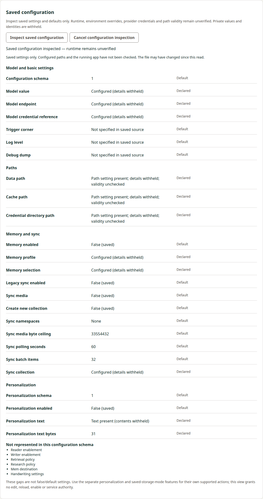
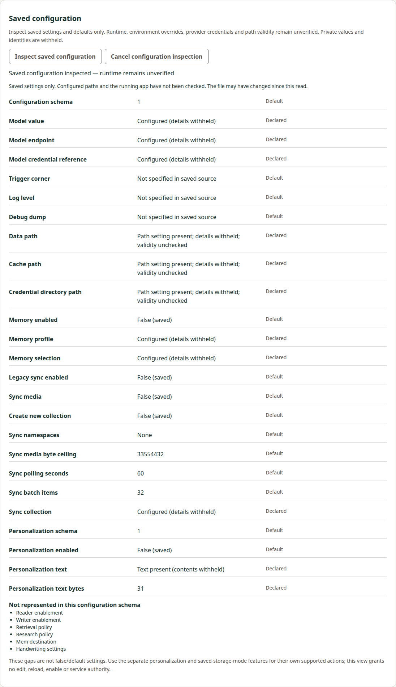
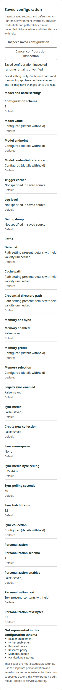
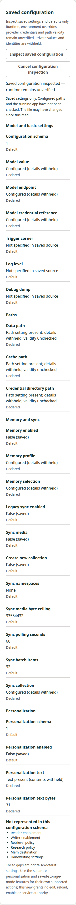

# Consumer implementation evidence

Source basis: actual Manager bounded-preparation fixture candidate `25e7f5a` (accepted GC repair `787aef7`, diagnostic `2671889`) (accepted configuration fixture `7e35e4f`) (accepted presentation `d186779`, initial implementation `bcfc53b`) on `feature/rem-42-saved-config-inspection`, accepted consumer precode `5def25f` / independent review5584741044, accepted producer contract `2a320181`, and original native producer corpus. Local execution below uses synthetic transports and identities; no tablet or provider contact occurred.

## Implementation and preservation

The fixed no-remote-stdin transport, strict private report/reduced public view, optional protected browser/Electron method, shared queued controller and explicit 25-row panel grouped as Model and basic settings, Paths, Memory and sync, and Personalization are implemented. The private digest is validated then discarded. Origins, nullable versus default values, all consistency rules and six unsupported capabilities are preserved; runtime/path validity remain unverified.

Main-document navigation invalidates the wrapped observer generation; same-path resources/subframes and same-document Electron navigation do not. The modern installed Electron navigation-event shape is used. Before-I/O external forget invalidation retains the raw observer receiver and original unknown-intent bytes. Each host rechecks generation after awaits and before public output. Controller cancellation uses the existing ConnectionController queue.

Initial scope preserved166 unrelated entries from actual Manager `3c789a00373873b4813c6105c7ee79c2a2fab386` are byte-identical;16 existing paths changed and11 paths were added initially. The later inherited memory-query diagnostic adds one existing fixture path; current29-path scope (including the later preparation fixture) leaves164 unrelated base entries exact. Dependency/lockfile, SDK and release/version machinery are unchanged; package.json has no own maintained version. Workflow changes add commands inside existing jobs only; all10 unchanged workflow graph controls pass. All517 unrelated entries from actual Docs `54085ec1062cd15927cc3db3288a2c23342ba936` remain preserved.

## Original producer compatibility

The fixture is copied byte-for-byte from [Buddy0e0eec73](https://github.com/s116821/ReMarkableBuddies/blob/0e0eec73e5579d6f160789fd0e3c0da8e7dbde8a/tests/fixtures/saved-configuration-4bc7eb0-corpus.json):56,340bytes, SHA256 `a8c227a996c0028ee69d9d072803921c0d6b12e4902fddc2bcc785e07e792407`. All35 cases/all70 input and original stdout hashes pass the actual new consumer parser/controller controls, including defaults, typed/null origins, privacy/refusals and input limits. Expected stdout is not reconstructed or reserialized. No producer cases were rerun.

Capture attribution remains source `4bc7eb0c6bf55af8392ee36a8eb3a7ca400a5389` and capture-time executable SHA256 `281fb6ea67c4028fae95a9c657e7058a0a1037c2d726bf2c4ced31bdba77d211`. Later producer `81c51ea` adds only inventory/default test assertions. Full producer implementation reviews5584712721/5584713481 and narrow5584769318 were read; producer full CI/delivery remains separate.

## Local verification

- All176 Node tests pass (167 previous plus nine new); six core and three real-helper controls cover strict schemas, original reports, actual bounded child collector, ready/unknown forget interoperability, shared cancel ordering, authentication, canonical request and final after-await generation checks.
- Seven Python transport controls pass using an actual local SSH peer with public deterministic fixture identities: fixed command/no remote stdin, inclusive stdout131072/stderr8192 limits, duplicate/UTF8/partial/nonzero/timeout/identity failures and bounded outer response.
- Lint, development and production builds pass. Ten workflow graph controls pass.
- Actual development browser and source Electron UI pass with installed auth/arity/frame/coordinator guards. Synthetic lower transport exercises safe rows/origins, private absence, same-ID refresh, main-document versus same-path resource/subframe navigation, cancellation and reload. A focused Electron case temporarily replaces the observer method only to schedule cancellation after its result, independently proving the actual final IPC after-await guard; the original method is restored before normal UI execution.
- Browser and native Electron captures at actual390px and1280px viewports were visually inspected: all25 rows, four headings and six gap labels are readable; no hidden strings/digest are present. Existing public guide includes the fixed manual equivalent.

Review follow-up: the initial25-row panel was flat, and its390px check retained no narrow image. Independent review requested the already agreed groups and actual narrow visual evidence. The successor changes only app template/computed presentation and the existing UI fixture, which now asserts all four headings and captures both widths inside every ordinary development/source/retained run. No wire/parser/transport/guard or workflow-job changes. Lint and both builds plus the complete browser/source Electron fixture pass after this change; the original176 Node/seven Python/ten graph evidence remains attributed to initial implementation.

Initial Node strip-only loading rejected a TypeScript parameter property; an explicit field/constructor replaced it. Original failed log remains retained. Existing forget navigation fixture now sends actual document Fetch Metadata instead of classifying an arbitrary fetch as navigation. Guards were not weakened to repair fixtures.

## Historical hosted failure and diagnostic checkpoint

The initialbcfc53 ordinary pipeline39422404915 failed both OS feature fixtures at the resource/subframe unchanged-generation assertion before executing the new retained feature path (Linux23vs22, Windows22vs21). Complete native logs are retained. Earlier controls passed, but neither feature package path is qualified by that run. These failures are not relabeled as passing or presumed to be polling.

Local actual browser/source Electron runs with a deliberately delayed five-second frame and with CI=true pass. At that historical checkpoint, the diagnostic-only successor2458423 preserved every product byte and adds a failure-message trace of synthetic request Fetch Metadata and original-cancel call stacks/timestamps to the existing assertion. It was evidence collection, not a fix or proof of the then-unexplained mismatch. The deliberate local delay was removed before publication; no guard/assertion/deadline changed. That checkpoint was superseded by the named trace and accepted fixture corrections below.

This Docs branch now includes actual producer delivery7b30033b9e304c117ef6ac24dd5ce6f1414cc442 via normal merge5bb8e5e. Its canonical capability and six-artifact archive are preserved byte-exact. Producer main/publication remains separately owned and is not inferred from its merge.

## Named cancellation and fixture correction

Completed diagnostic Linux job118639973335 in run39424575078 retains91,270bytes SHA256 `b9a1be9c6e96508cf66337d94a82837c97afbd3f074ff708bb3fc72097e7a1c6`. Its original53-event array shows generation21 at the previous fixture run, then a14.274s gap. The next POST /manager-host triggers the real queued pause cancel; iframe GET arrives as iframe without cancellation; the next POST /manager-saved-configuration triggers its own run cancel; the empty-resource GET causes no cancellation. The failed equality is23vs21. Root independently read the same native bytes/events and corroborated this sequence. Windows job118639973480 independently shows the same ordered source calls and correct iframe/empty metadata; its full native log SHA256 is `3ed70f9268eb77d98719681e3e45b8fb4522599cdb6e3c885e2d760e2ea20807`. This is not evidence of polling or incorrect resource/navigation invalidation.

The global pending resolver could describe an earlier invocation rather than the read being asserted; mutable fixture mode plus repeated negative labels also allowed state selection to race request startup. The fixture-corrected successor uses queued per-invocation mode tickets, waits for that exact invocation's transport start/pending resolver and releases original callbacks by ticket. The unchanged generation equality now starts after the intended pause/run. Added coverage keeps an older cancelled callback pending while a new invocation runs both same-path resource/subframe checks and the same equality. Lint and the full actual dev-browser/source-Electron feature fixture pass. Every product byte, public guard, timeout and original producer specimen remains unchanged from accepted d186779. An initial local helper-rewrite recursion error was corrected; its failed log is retained separately from the passing corrected run.

The retainedd186 development browser artifact (773796bytes, merge54255216) also passed locally before the correction using the same Chromium153.0.8010.12 as CI, so that was truthful nonreproduction rather than qualification. Earlierbcfc/d186 failures and the diagnostic failure stay retained. Remaining obsolete d186 Windows work was cancelled only after its run's Linux failure was preserved, to free the existing serial slot. The diagnostic run completed naturally before its cancellation request, which was rejected and not retried. No failed result was counted as passing, no rerun or workflow/settings change occurred.

Narrow review of f7174ef accepted the ticket/start correction but identified consecutive unsupported labels as insufficient UI-completion evidence. Successor7e35e4f moves the distinct raw/response-refused case between unsupported and future, preserving all five cases and making every consecutive negative outcome distinguishable. Lint/full actual local browser/source Electron fixture pass again. The obsolete f717 validation run was cancelled as superseded; it is not qualification. Independent narrow review and ordinary exact-head Linux/Windows package checks for the final correction remain open. Own canonical synchronization/archive, final composition/delivery and observed main/publication remain later gates.

## Historical Windows enablement failure and passive diagnosis

Run39428731671 at accepted7e35 passed Linux job118649221218, with all four configuration feature markers and final upload-byte verification. The actual tested merge3b39593daae9ad4b05682ed346bf5f4398fea3b6 has the exact reviewed source tree9c789e987c19c14c4cd47ebf82368b82be36915c. Linux native log86,548bytes SHA256 `9b61f1ed9b291c5efd6922dc52d1a145989a13d38bff3a39e77e188641ccb693` is retained. This is Linux evidence, not completed cross-OS qualification.

Windows job118649220869 failed earlier, in the inherited packaged Electron memory-query fixture at its negative-result loop: Search global memory stayed disabled for the original30s click timeout. New configuration Windows controls were not reached. The full55,005-byte native log SHA256 `f1e7fd1c18df77304164a8062df98292403759a3cbd9db8fe357a2a367ecee6b` is retained/read and independently corroborated by Root. Do not conflate this with the corrected configuration-generation test.

At the passive-diagnostic267 checkpoint, cause remained unverified. The desktop preload uses direct observe IPC, and this existing fixture replaces the real observe handler with a forever-pending promise after the first sample, so the browser14s deadline alone does not explain the desktop failure. Search enablement derives from observation/profile, method availability and input validity, not query busy. Diagnostic2671889 changes only that inherited fixture: passive input-event/length/UTF8-validity, current mode, connection/model presence and observation-count samples around capture and clicks are emitted only on failure. Synthetic query content is not logged. Original assertions/guards/timeouts remain unchanged; lint and actual local browser/source Electron memory-query fixture pass. No blind retry or product change is claimed as a fix.

This records the pre-repair checkpoint. Subsequent controlled GC evidence and the independently accepted retention repair follow below.

## Controlled observation/GC reproduction and fixture repair

An actual local Electron control waits for the existing scheduled observation, then forces three main-process GC cycles. With the original unrooted never-promise handler, a parallel direct observe rejects with `reply was never sent`; connection changes to Tablet state unavailable and the same partial-case Search click fails. Failure telemetry shows valid synthetic input (14characters/22UTF8bytes), one unchanged input event, three observation calls, no model and disabled Search. The complete temporary control variant and failed native log are retained. This demonstrates the named failure mechanism locally; the original Windows CI GC timing was not directly recorded.

The installed runtime reports dependency metadata44.4.5. Exact upstream [ReplyChannel header](https://github.com/electron/electron/blob/694f45852a0f1726cd23bfd379854de489cccb65/shell/common/gin_helper/reply_channel.h) registers its GC pre-finalizer, [implementation](https://github.com/electron/electron/blob/694f45852a0f1726cd23bfd379854de489cccb65/shell/common/gin_helper/reply_channel.cc) sends the observed fallback for a collected unreplied channel, and [IPC dispatch](https://github.com/electron/electron/blob/694f45852a0f1726cd23bfd379854de489cccb65/lib/browser/ipc-dispatch.ts) awaits the handler. This is primary-source reasoning, not an inference from a renderer timeout.

Matched control retains the synthetic observation resolvers across the SAME GC sequence: direct observe remains pending, connection remains Wired tablet observed, Search is enabled and the complete semantic fixture passes. The corrected fixture owns those resolvers until cleanup, then resolves/clears them explicitly. Its normal source/retained Electron path now waits for the pending scheduled read, forces the GC regression, asserts the one rooted completion and live connection/Search, then continues native capture and every original semantic/cancellation assertion. Passive failure telemetry remains; no query content is logged.

Lint and actual local browser/source Electron with the permanent GC regression pass. Every product file, real safety predicate, original polling interval and deadline is unchanged; only the existing inherited fixture changed. Root accepted the retention repair in full review5585979446 and canonical5a194ea0, with no source findings. Passive predecessor267 later passed ordinary Windows job118659684069 (native64,301bytes SHA25664887e016c9f0237e6c0aba478b8c85ec6c325e3e55ee9d3c2f285673b2b86ec), including all four configuration feature markers and final upload-byte verification. It emitted no failure snapshot, so original GC timing remains unrecorded. That predecessor is not qualification of787's new regression. That run later passed Linux but failed the separate preparation fixture below; it is not qualification of the current successor.

## Bounded preparation response versus preview paint

Completed787 Windows job118667283643 (71,937bytes, SHA256 `b1694713d046e558b2ce77be9f3d654f2c766fad4b7fad549021bc85ee3ea799`) passed source/packaged Electron memory-query controls with the forced-GC regression. It failed later at the development-browser memory-forget initial preview: Café Ω was absent after the default5s UI matcher while the UI still reported preparing. The configuration Windows fixture was not reached. The original preparation latency/source was not timed, so no underlying CPU/network cause is claimed.

A controlled six-second initial synthetic preparation reproduces the original absent-preview5s failure while remaining within the existing operation budget. The matched25e7f5a fixture correlates that exact initial authenticated public prepare response, bounded by the existing14s request deadline, verifiesHTTP200/prepared, then executes every original unchanged5s UI/Unicode/scope assertion. The six-second control remains in the ordinary browser fixture so an early paint assertion cannot regress. Local full browser/source Electron passes; observed public response completed in6097ms. Confirmation count, privacy, invalidation, receipt and unknown-outcome cases remain unchanged. Product code, backend/transport/client limits and polling are unchanged; this is phase synchronization, not a global timeout increase.

The narrow successor changes only the inherited memory-forget fixture. Overall29 scoped paths preserve164 unrelated original source entries. At that checkpoint exact-head ordinary Linux/Windows checks and narrow review remained pending; all failed native evidence and before/after variants stay retained. The accepted25e review and subsequent run are recorded below.

## Reload bootstrap/status readiness correction

Root accepted25e7f5a in review5586361090. Its ordinary run39437529640 passed Linux job118679985350, all six memory-query/configuration markers, both bounded preparation-response controls and final upload-byte verification. Complete86,761-byte native log SHA256 `ae26c2936f58f55b991df6a032d3fc6c3f4f18b7b5a0d84f4752c0824c1f4703` remains retained. Windows job118679985307 passed the memory-query controls and completed the initial preparation response in6795ms, then failed at the later post-reload unknown-status assertion: the status element was absent for the original5s matcher. Its complete55,126-byte native log SHA256 `6e3a53f9fb6d5f245436c897c738ca025bbe5f5ae66f13e05ff68b5d8f0d5cdc` is retained. No configuration Windows qualification is claimed.

Unchanged source makes the status element unconditional, starts Angular bootstrap asynchronously, and launches the constructor's retained-status request without awaiting it. A controlled6s loopback startup-status delay causes the old5s assertion to fail with the existing element still reading Checking retained host request. That establishes a missing request-completion precondition, but does NOT reproduce or explain Windows's missing element. Its original bootstrap/render timing remains unrecorded; no CPU/network cause is asserted.

The narrow fixture successor waits for the actual post-reload authenticated public startup-status response and an independently visible structural app heading, using the existing14s request bound. It verifiesHTTP200/unknown before the unchanged5s semantic assertion. A fresh request-event set excludes responses from requests started before reload. Both browser and Electron additionally assert the same original opaque unknown reference before/after reload, preserving receipt identity without printing it or issuing another mutation. Original four confirmation calls, Unicode/privacy/receipt/cancel cases remain intact. No product, guard, polling or deadline changes.

The6s startup-status control remains in ordinary browser execution and passes locally with response at6204ms, startup request at193ms and zero page errors. Full development browser/source Electron and lint pass. On future readiness failures, bounded diagnostics record request/response times, the main-document path/status/time, at most five200-character console/page errors, and body/app-root structural snapshots capped at64 descendant tags. DOM text/attributes are excluded; the exact fixed bootstrap-failure fallback is reported as a boolean. These synthetic-fixture diagnostics distinguish missing DOM/bootstrap refusal from pending status without logging public response bodies, query text or private reports. The original Windows cause remains unverified. This diagnostic extension does not change success predicates or timeouts. Its normal full browser/source Electron run passes (startup response6145ms, main documentHTTP200 at22ms). A separate temporary negative control substitutes a throwing synthetic reload module through the existing loopback route seam: the14s status wait correctly fails, diagnostic recordsHTTP200 at20ms, readyState complete, empty app-root, absent status and SYNTHETIC_RELOAD_BOOTSTRAP_FAILURE. It does not misclassify that as pending status or claim the fixed application fallback ran. The temporary control is retained outside source and removed before commit; original Windows cause remains unproved. Independent narrow review and new exact-head both-OS ordinary CI remain required; earlier failures are not reclassified as passing.

## Still open

Ordinary exact-head Linux/Windows development and retained-package browser/Electron jobs, accepted implementation plus current narrow-review confirmation, own canonical synchronization/archive, final qualified producer composition, exact-head final review and normal delivery remain open. Actual merged trees, main CI and official publication will be observed separately. This is not a package/native/runtime qualification or broad REM42 completion. No local package rebuild, new worker/chat/worktree, tablet or account action was used.
