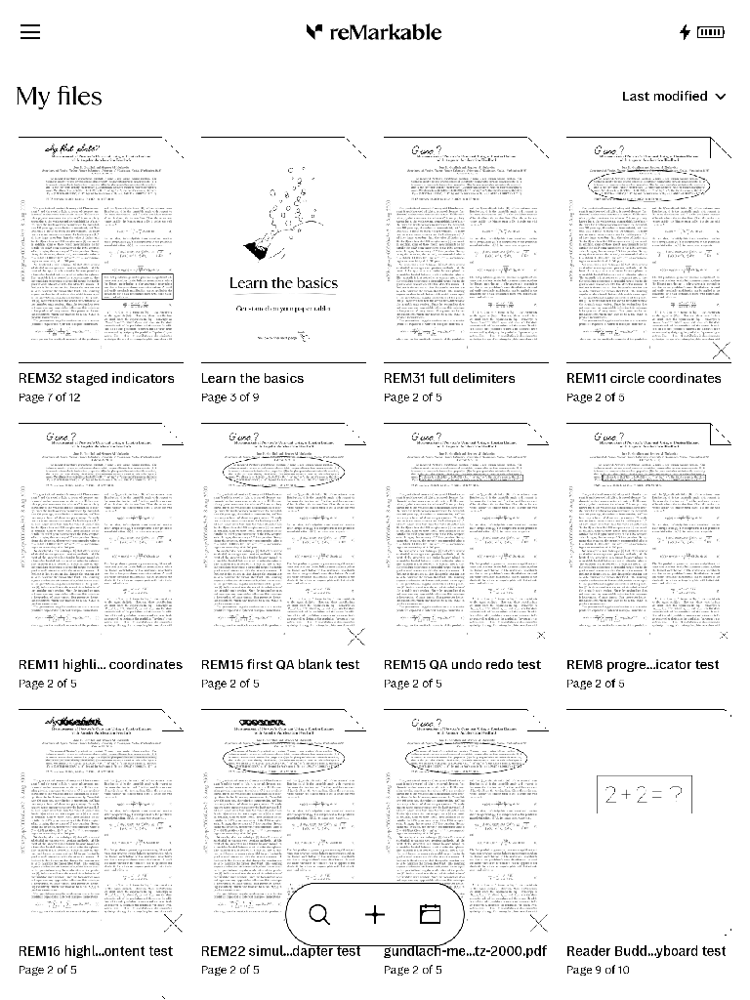

# Opening metadata policy source result

The optional version-2 policy in [resident-capture-setup.md](resident-capture-setup.md)
is implemented in the existing development bootstrap controller. It binds the
original content and metadata bytes to the complete original manifest, derives
both paths from the selected document UUID, and checks the original full order.
Only the specified typed opening activity fields may change after durable matching
setup history exists. Actor completion and stock-first recovery share the same
policy. Missing setup-ready retains byte-exact preservation; invalid history
refuses the allowance. Version-1 candidates and version-2 candidates without the
policy retain byte-exact behavior.

Both actual file samples must match the sampled inventory and retain their file
pins through comparison. Bounded rejected samples are retained in private
evidence. All other paths, types and file hashes remain protected. The policy
does not write or restore source files and does not establish current UI identity.

Independent source review caught an initial protected-number comparison defect:
parsing unknown JSON numbers through floating point could collapse distinct large
integers or precise decimals. The corrected comparison preserves exact raw number
tokens, rejects recursive duplicate keys, and conservatively refuses equivalent
alternate numeric spellings. Review of the corrected parser and production
sampling path found no remaining concrete source blocker.

## Validation

Final source validation in the owned root Linux container passed:

- All-feature library suite: 752 passed, 9 explicitly ignored.
- Bootstrap suite with `--include-ignored`: 29 passed, including protected-root
  filesystem tests and the setup history test with departed historical processes.
- All-target/all-feature Clippy with warnings denied; Rust formatting; whitespace;
  and the diagnostic exclusion workflow regression.

The filesystem regression uses the production sample reader: stale inventory,
changed samples and identical-byte inode replacement refuse; rejected sample
bytes remain available. JSON regressions cover overflow-sized integers, precise
decimals, underflow, signed zero and exponent spelling, along with allowed activity,
regression, unrelated pages, order changes, unknown fields and inventory drift.

Logs `opening-policy-linux-r1`, `r2` and `r3` retain the progression. The earlier
27-test pass preceded the numerical correction; the 28-test pass preceded the
final filesystem regression. Only `r3` covers the final source. These are source
and modeled host results; actual native opening/capture and installed product
acceptance remain unfinished. Exact source revisions and hosted results are linked
in the paired PR evidence comments.

## Separate native failure: vendor screenshot signal

On RM2 firmware 3.28.0.172, the installed `/usr/bin/screenshot` was a 382-byte
script sending SIGUSR2 to xochitl. Its SHA-256 was
`0df64fae1c03699565ccedb38d51374fa840358c1eeac7733568f3b37b98a3b5`.
One process-bound attempt on October 28, 2026 produced no PNG. The journal
reported `code=killed, status=12/USR2`; systemd automatically restarted stock.
Read-only follow-up verified stock, Buddy and sync services active with no pending
jobs, and all 161 original source-file paths and hashes unchanged. It did not
visually verify the restored UI. The before/after manifest SHA-256 was
`2e819596cd8b130139db437acd3fdd8db6ef6eaff29b1326acd88174b19c0f65`.

The selected attempt is spent. Do not repeat this signal as a screenshot/setup
shortcut on this profile or infer a loaded signal handler from the script's
presence. The SDK capture path is separate and was not exercised. Its next
candidate requires the new stock process identity, reviewed setup mechanism and
fresh source admission. Private raw receipts and journal are preserved; this
sanitized record excludes device/account identifiers. The host preservation
model covers typed policy and inventory failures; it does not simulate vendor
signal handling or prove on-device recovery.

## Process-bound visual follow-up

A separately selected memory-read screenshot succeeded on the same firmware with
Buddy `247833198746731774bef2cb5adfce1b0db87b61`, source tree
`939a07a49d1b6080b4729addb2140005ef1a0300`. The existing screenshot example was
cross-built with the locked dependencies and pinned release cross image. ARM32
binary SHA-256 was
`8929a991540e5a596514882e9f312a4255a469092e59a9fea45c689af89ad6f2`.
The source tree was clean after the build; unavailable embedded Git metadata is
recorded separately from this external source/build provenance.

One unique transient service imposed a 20-second runtime limit and invoked the
helper against the exact stock boot/PID/start identity and running executable
hash. It sent no signal, input or stock-service command. The helper completed
successfully and was terminal. Completed source/service postchecks verified the
same 161 source-file paths and hashes and unchanged stock/Buddy/sync identities.
The before/after source manifest remains the value recorded above.

The retrieved 768-by-1024 PNG was fully decoded and visually inspected. It shows
the stock My files screen and the 12-page disposable fixture in the top-left tile.
PNG SHA-256 is
`85e12893948eaa433a629d9735e839146a0ca2dfe4881b8d1be2b6485da547d6`.
This identifies a visual setup target; it does not prove Reader page identity,
native allocation ownership, SDK capture or product readiness.

Independent runner review corrected postcheck acceptance of matching stdout
after a late SSH failure, and ensured traversal and individual hash failures
propagate before sorting. Five fake-SSH tests cover successful postchecks and
matching-output nonzero/timeout results for each postcheck. The runner and exact
command/output receipts are retained privately with the image; evidence-copy
manifest SHA-256 is
`e6863f400156654fd34841f7514f7224739d695c84491c50efc615852848ff99`.
This attempt is consumed. Future setup/capture requires its own fresh selection.
