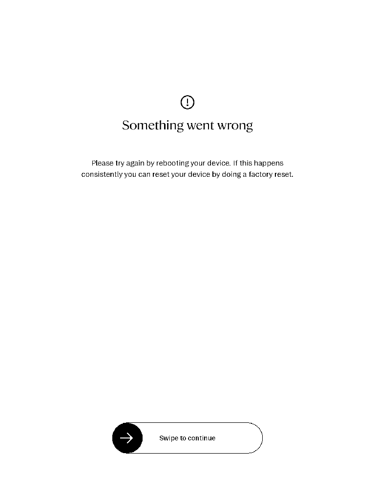

# Resident setup error-screen refusal

The fresh `1a94e48d31674442999f1ad894737cb5` native capture candidate reached
transport/setup readiness, but its copied reader displayed the error screen below.
The operator withheld the planned fixture-opening tap and setup completion.
No SDK CaptureSource result, insertion, navigation or writing was obtained.
This attempt is spent and must not be replayed.

## Exact evidence

The controller and observer came from the independently reviewed CI merge
`3cd7d6dbdb08fe8ef8b552ee904dec4013a7f4c6`, tree
`f4deed57e2e440eb5ae10ce53c4b7da57f0ff80d`, run `40736982228`.
They were not built from the newer screenshot-helper source. The SDK adapter
remained `80b29ebec3a46b6976e5288d2e8d65fbeccca816`, with mutation disabled.
Candidate SHA-256:
`a5c3983d34f95c7b8636d6a19f22fd2f3237939d50679e6581fae305180417a6`.

The separate screenshot helper was locally cross-built from clean Buddy
`228f151151712a6b27c042e5e6a3e9649bb21775`, tree
`849098ebfd496ebcb25038a724d2a615a5ebd7bf`, with
`development-resident-bootstrap`. Its ARM32 binary SHA-256 was
`fe6e8f9b7072ab43df1ec5eb8dd163a58eb647cd77bbe4fc580e2fc17d827df9`.
The 9,096,472-byte binary's interpreter and source hashes were verified. Frozen
build/source/log manifest:
`b80468209609117ed6025a6a8bc298eefce5e49eaac7bc582b479cc9f72ae661`.

All five staging calls and all four before-image calls returned success.
The copied-reader helper ran once under its bounded PID1 service against the
ready-bound process. The retrieved 768-by-1024 PNG was fully decoded and visually
inspected. Its SHA-256 is
`82b1ee621f90d498510ccfb24b9649e0c86797086a14a0e4a076edd805e2bf41`.
It proves the observed error screen, not native page identity or SDK capture.
No tap, after-image or setup-complete step was selected.

## Recovery and preservation

The actor recorded a service-observation deadline error. That error reported its
observation subprocess reaped; it is not a native-reader shutdown receipt. The
capture runner retained the missing observation/PNG collection as failures.
Only the early actor-ended, observer-ended and ready setup records exist.
Independent recovery recorded `Ok(())` and restored stock and Buddy. Its sampled
content and metadata bytes exactly matched the originals.

A separately reviewed cleanup admitted this failed run using the exact execution
receipt and control-archive hashes. It freshly verified the complete original
source inventory, real service baselines and unit-file hashes, unchanged control
evidence, namespace/cgroup context, terminal diagnostics and absent diagnostic/
before-helper groups. It accepted only original diagnostic invocation/start
identities or the explicitly fully cleared inactive/dead state; partial clearing
or a different invocation refuses. Two focused host regressions cover that rule.

Cleanup succeeded: only the failed diagnostic actor was reset, and only the two
experiment service definitions were removed. Final checks confirmed their absence,
the unchanged restored stock/Buddy service instances and all original source paths
and hashes. Payloads, images, logs, control records and failures remain preserved.
The successful recovery and cleanup do not turn this setup refusal into a pass.

A separate fresh stock visual sample, `98cd6cb4709141b7aae6c393131f409b`, used
the previously frozen stock helper built from Buddy `2478331`. All 12 calls
succeeded. The fully decoded and inspected image shows normal My files and is
pixel-identical to the earlier stock screenshot (PNG SHA-256
`85e12893948eaa433a629d9735e839146a0ca2dfe4881b8d1be2b6485da547d6`).
All 161 source-file hashes and stock/Buddy/sync service instances remained
unchanged during that sample. This confirms the restored visible stock state;
it does not establish a native Reader page identity.

## Remaining diagnosis

The retained native log includes a non-UTF-8 locale warning and generic missing-bin
warnings, but does not establish the error screen's cause. A subsequent read-only
comparison found stock uses `LANG=en_US.UTF-8` and a broader PATH, whereas the
diagnostic observer selected `LANG=C` and `/usr/bin:/bin`. Both use `--system` and
working directory `/`. These are observed differences, not a demonstrated cause.
No new runtime selection follows from this comparison.

Native opening/capture, installed first-gesture acquisition and automatic
Reader/Writer/blank-start creation/reuse remain open, along with the integrated
simulator, review and coordinated spec completion gates.

Source basis: current source/build proof, actual helper image, retained native
logs and recovery records, fresh successful cleanup, and bounded read-only stock
launch-context inspection. Root-cause hypotheses remain unverified.
